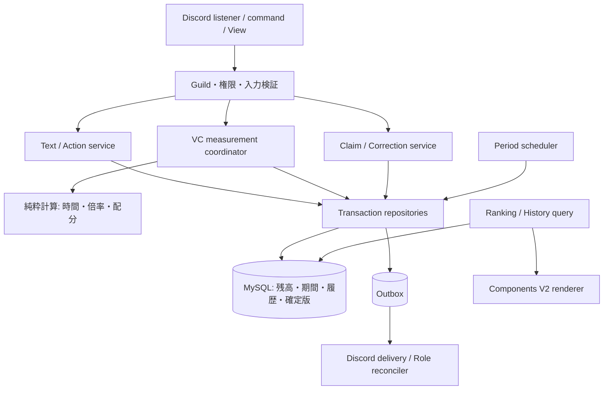
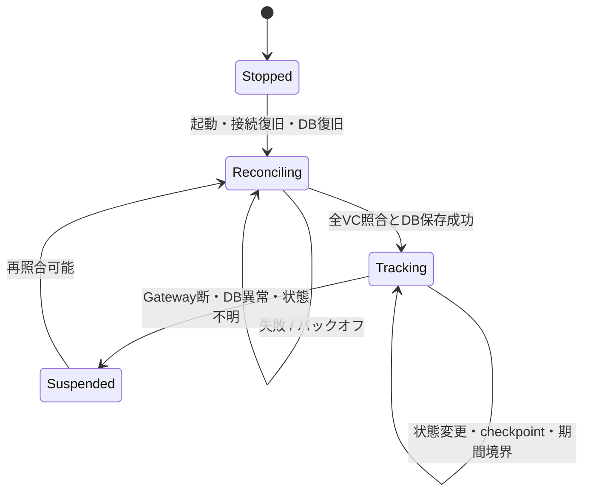

# レベリング改修 アーキテクチャ

2026-11-01 / P1・P2基盤実装。Discord接続は後続フェーズ。契約と未決定事項は [要件](LEVELING_REQUIREMENTS.md) を正本とする。

## 1. 構成と責務

| 配置案 | 責務 |
|---|---|
| `app/features/leveling/cog.py` | listener・task登録と依存接続のみ。計算・SQLを持たない |
| `domain/` | 現行成長式、期間境界、VC計算、最大剰余、報酬判定、数値検証 |
| `services/` | text/action、VC計測、受取、締め、訂正、履歴照会、外部副作用の調整 |
| `commands/`, `views/` | 日本語引数と応答、callbackごとの認可。既存永続ボタン `claim_voice_xp` を維持 |
| `messages/` | 表示文言のみ。計算・Discord操作・DB参照を持たない |
| `app/database/models/`, `repositories/` | 永続化とトランザクション。DTOを返す。DatabaseRepositoriesへ接続 |
| `app/features/roles/` | 再参加復元の責務。月間ロール除外を保存時・復元時両方に適用 |

300行程度を分割の目安とし、長い既存Cog/UIファイルをそのまま拡張しない。単一Guild・単一Botプロセスを維持。複数worker向け分散計測は対象外。

## 2. 通常テキスト・アクション

1. 対象Guildを確認してからcache・DB・副作用へ進む。
2. アクションは指定チャンネル、`author.bot`、許可Bot IDをすべて確認。Webhookを許可Botになりすました入力として受け付けない。正の整数値を解析し、通常XPルートへ流さない。
3. 通常入力はMember、非Bot、default種別、除外条件を検証。クールダウンはユーザー単位、現行どおり境界ちょうども拒否。DB成功時に更新する案を採用し、失敗で権利を消費しない。
4. ユーザー排他内で重複キーを確認。乱数・倍率・入力を固定したイベント案を作る。テキストのVCチャット調整を維持するが、分類はテキストである。
5. 対象日・週・月を作成／ロックし、各期間の確定状態を独立判定。イベント・重複キー・受入期間への加算・恒常成長・必要なoutboxを同一commit。全部確定した場合も通常の獲得条件と重複防止を満たす恒常シャードは付与する（DR06）。期間パワーは全て不受理。詳細は§11。
6. 重複は副作用なし。commit結果不明なら同一キーを照会して判定し、別キーで再送しない。通知失敗で成長・集計を戻さない。

テキスト基礎値Bは既存調整後の整数、率rのとき最終シャード `floor(B*(1+r/100))`、基本B、ボーナスは最終-B、パワーB。有効ブーストは `[start,end)`。アクションはメッセージ作成時刻、シャード0、チャンネル配分0。

## 3. VCの状態と時間

在室だけでは計測しない。Botを除き、server/self mute・deaf・AFKのいずれもない者が2人以上で有効。除外ロール保持者はこの人数には含め、本人の付与だけ停止。除外チャンネルは付与停止。入退室・移動・mute・ロール変更は当人だけでなく旧／新チャンネルの参加者全員の資格を更新する。

処理開始時にmutation gateを共有取得し、チャンネル状態変更を短いcoordinator排他で順序付けして、影響ユーザーID昇順でロックする。各ユーザーの既知区間を旧状態で精算してから新状態へ進む。coordinatorを含む階層とDBロック取得順はDB文書§3に統一。受取・締め処理と逆順にロックを取らない。

区間をチャンネル・有効率・両上限の獲得可否・期間境界で分割する。通常は60秒未満をユーザー別に保持し、移動・一時退出・ミュートでも既知の端数は捨てない。再参加時に接続するのは保存済み端数だけで、空白時間は含めない。チェックポイントは既定10秒、照合は既定60秒、状態変更でも保存する。

同一時刻の日・週・月境界は一つの精算点とする。区間終端が境界なら前期間へ帰属。次の時刻から新期間。保存済み端数が停止中に境界を越えた場合、復旧時に旧区間だけを比例精算し、不明な秒数を追加しない。

### 3.1 60秒単位と比例計算

技術案: 乱数Rは60秒量として1付与単位につき1回抽選し、イベントキーとともに固定する。上限が片方だけ停止した場合、その側の停止秒数は加算対象から除き、もう一方の有効秒を計測する。両側停止時は付与用時計を進めない。受取で再開しても停止中の秒数を後から加算しない。

通常単位の長さD=60秒、境界残余は0<D<60。区間iの秒数di、率ri、係数aに対し、シャード獲得可能区間集合S、パワー獲得可能区間集合Pを用いる。

- 未丸め基本シャード `X = R*a*Σ(Sのdi)/60`
- 未丸め最終シャード `Y = R*a*Σ(Sのdi*(1+ri/100))/60`
- 基本 `floor(X)`、最終 `floor(Y)`、ボーナス `floor(Y)-floor(X)`。途中で秒ごとの切捨てをしない。
- パワー `floor(R*a*Σ(Pのdi)/60)`。倍率を掛けない。
- 残りシャード枠で最終量をclipする場合、基本から先に満たし、残りをボーナスにする。パワーは独立枠でclip。
- 実際に加算したパワー整数をPのチャンネル別滞在時間で最大剰余配分。各床値を割り当て、残りを剰余降順／ID昇順へ1ずつ配る。合計保存を保証。

例: R=20,a=0.3、Aに30秒（率0%）、Bに30秒（率100%）なら基本6、最終9、ボーナス3、パワー6をA/Bへ3ずつ。境界20秒なら無倍率で2。R=10,a=0.3、A/B各30秒ならパワー3、低いチャンネルIDへ2、他方へ1。

0量となった境界精算も履歴へ保存し端数を消費する。丸められた小数は次期へ持ち越さない。checkpointは付与単位を変えず、乱数の再抽選を発生させない。

### 3.2 障害と初期照合

- 起動時に保存済み `tracking` を信用せず停止扱いにする。計測epochを更新し、前プロセスの時刻から差分を作らない。
- 全VCのスナップショット取得中はイベントをユーザー別最新状態＋世代番号に集約。スナップショットの後にキューを適用し、影響チャンネル全体を再判定。世代が変わった対象は再確認する。全体整合とDB保存成功後に新計測開始。
- 照合失敗は5,10,20,40,60,60…秒で再試行（config、jitterで最大を越えない）。GatewayとDB双方の正常確認を再開条件とする。
- DB commit結果不明は付与キーとcheckpoint版を照会。成功済みを二重適用しない。未保存区間は再建できると断定せず捨て、最後の成功checkpointを保持する。
- Gateway断・照合で不整合を見つけたら、不明区間を最後の信頼点から除外。既に確定済みのイベントを推測で取り消さない。必要な修正は訂正フローへ。
- 正常終了は計測停止後に既知区間を保存。強制終了では未保存秒数の損失を許容する。
- 障害開始・復旧の状態遷移だけを既存エラー報告先へ送り、繰返し障害はログに集約。報告先障害はログへfallbackし再帰報告しない。自動修正不能の不整合だけ管理者対応を要求する。専用障害履歴表は作らない。

## 4. 受取・上限

パワーは既にランキングへ反映済み。pendingのpowerは受取枠の消費量であって未計上ランキングではない。期間・移行由来別pendingを持ち、ユーザー総枠はその合計。手動受取は対象行をロックし、voice/bonusを恒常へ一度加算、power枠を解放。powerだけ残る場合も受取可能。

上限通知はユーザーの受取サイクル単位。どちらか先に上限到達したcommitで通知フラグを立て、同時なら「両方」とする。送信前に試行済みにするため失敗・クラッシュでも再送しない。手動受取で両枠解放し新サイクルへ。月末自動受取は前月分だけを除き、残る新月分を壊さない。合計が両上限未満になったときだけ通知サイクルを再開する。50%通知は廃止。

月末は退出者も含む全員を処理し、Discord Member不在を受取不可理由にしない。新月の手動受取との競合は同一ユーザー・pendingロックで直列化する。

## 5. 締め処理と復旧

schedulerは起動時と定期実行で移行開始以降の期限を過ぎた全OPEN期間を列挙し古い順に処理する。空期間も確定する。日・週・月の一つの失敗が別種類の締めを永久停止させない。

1. VC coordinatorに境界以前の既知区間の保存・精算を要求する。DB障害なら締めも待つ。不明な停止区間は0。
2. 日／週も境界drain後に排他mutation gateを取得し、対象period行をロックし、待機中writerが完了してから残高を固定。順位全件を新revisionに作成し、FINALIZEDと公開revisionを同一commit。
3. 月はmutation gate共有下で前月pendingを事前にユーザー単位で自動受取して負荷分散する。共有ゲートと全アプリ／DBロックを解放してから排他ゲートを取得する（昇格禁止）。最終トランザクションで必要なperiod全件を順序ロックし、事前処理後に増えた前月pendingを全件再確認・受取する。月間結果・連続TOP1判定・outbox・FINALIZEDを同時commit。ロック中は月を含む加算を待機させる。
4. commit直後に月間発表ジョブを起動。DiscordはDBトランザクションの外。確定版の正本は無期限保存し、公開commit後のOPEN作業表だけを安全に削除する（DB §7）。

締め中という理由で未確定遅延イベントを捨てない。締めロックより先なら含まれ、確定commit後ならその期間のみ不受理。大量月末pendingによる長トランザクションは移行前負荷試験で測定する。許容できなければ再開可能なfreeze設計への再設計が必要で、黙って早期締切を導入しない。

## 6. 訂正・報酬・外部副作用

管理者は期間、対象種別、ユーザー／チャンネル、絶対値、理由を指定。プレビューに対象revision、影響する全順位、TOP1/TOP10差分、後続月の連続記録、特別ロールの新規資格／喪失者を表示。喪失者ごとに維持／剥奪選択を必須化。Ephemeral確認ボタンは本人・管理者・Guildを再検証する。

承認時は排他mutation gateを先に取得し、全影響期間を順序ロックしてrevision一致を検証。不一致は適用せず再プレビュー。新revisionを全件生成し、前後差分・管理者判断・希望ロール・必要ジョブを同一commit。総合は内訳から計算し直接入力不可。チャンネル訂正は全体集計に同量反映し、全体addは未割当成分を変更し、set/removeがchannel合計を下回る場合は§10の比例縮小案による内訳変更もプレビューする。日・週・月へ暗黙伝播しない。連続月資格のみ後続月へ再判定する。

ロール同期は最新のDB希望状態を読む。古い月の再試行で現在の月間ロールを巻き戻さない。最新確定月のTOP1/TOP10を在籍者に同期し、永続資格は一度成立したものを維持する。過去の訂正で他の3連続期間が残る者は資格喪失でない。削除は明示承認した特別ロールのみ。Discord API呼出しはユーザー単位で直列化し、呼出し後に希望versionを再確認する。

outboxは処理状態、試行回数、次回時刻、lease、最後のエラー分類を保存。roleの希望状態同期はネットワーク・5xx・429でbackoff／Retry-After。メッセージPOSTは到達しなかったと証明できる失敗・明確な429だけ自動再試行し、timeout・切断・成功の可能性がある5xxは§13のUNKNOWNへ遷移する。403・削除済み設定先等はneeds_attentionとして運用通知し、設定修復後に再開。ジョブの失敗でランキングをrollbackしない。通常昇格通知とロール同期は別ジョブとし、一方の失敗が他方を止めない。

発表は期間・revision・partの識別マーカーと送信先・message IDを保存。送信結果不明はマーカー照合、取得できなければunknown状態で管理者確認し無限再送しない。訂正再発表は新revisionの明示ジョブ。通常再試行は同じpartを再利用する。

## 7. UI・履歴・発表の組立て

- 通常順位View: 期間セレクト（日／週／月）、指標セレクト、対象セレクト（全体／チャンネル同士／チャンネル内）、日付・チャンネル指定、5つのページ操作。全コントロールを同時に詰め込まず、対象選択で必要な行を切替える。
- 削除済みチャンネルはDiscord ChannelSelectでは選べないためDB名称による検索・候補ページを使用。日付はJSTで正規化して期間開始日を表示する。
- 閲覧は最新revisionを固定してページ移動。訂正で版が変わったら再読込を案内。OPEN期間はページごとに更新時刻を表示しライブ順位の移動を許容。
- `RANK()`の順位にuser_idを加えない。同率内の表示順だけuser_id昇順。順位計算後にLIMIT/OFFSET、総数から最終ページ算出。対象指標0を計算前に除外。
- 管理者履歴はEphemeral、期間指定を必須にして最大90日相当の窓を基本とし、受信時刻と獲得時刻を区別。ユーザー・チャンネル・種別を任意AND。検索で本文やトークンを保存・表示しない。CSV経路なし。
- 月間発表は4種のrank<=10をすべて取り、空種別は「対象なし」。総合は内訳付き詳細カード、種別も同じ意匠の簡潔なカード。実payloadを計測して収まるなら1件、越える場合だけカード単位で貪欲分割する。各partに期間・種別・通番・revision、同率を省略しない。ボタンなし。メンション表記は残し `allowed_mentions` で不要な通知を抑える。

Discord Components V2は通常content/embedsとの併用不可、総コンポーネント上限40。ネストと文字数を含めた制約をrendererで検査する。[公式概要](https://docs.discord.com/developers/components/overview)、[公式リファレンス](https://docs.discord.com/developers/components/reference)。値は実装時にも再確認する。

## 8. 設定案とログ

既存message cooldown、XP乱数範囲、voice_xp_adjust、報酬IDを再利用。追加案: `xp_excluded_channel_ids`, `xp_excluded_role_ids`, `action_power_bot_ids`, `voice_pending_shard_limit=300`, `voice_pending_power_limit=300`, `voice_checkpoint_seconds=10`, `voice_reconcile_seconds=60`, `voice_recovery_backoff_initial_seconds=5`, `voice_recovery_backoff_max_seconds=60`。旧voice_xp_limitは移行時に両上限へ写す。正の間隔・上限、min<=max、有限非負係数、backoff初回<=最大を検証し未知キーを拒否。設定変更前に既知VC区間を精算する。

通常獲得はdebug、管理操作・締め・移行・復旧はinfo、遅延不受理・不整合・Discord異常はwarning、重大停止はerror、予期しない例外はexception。event ID、period ID、actor/target ID、変更前後、操作種別を記録。秘密情報・メッセージ本文・生Discord objectは記録しない。上限通知以外の外部処理の再試行回数と滞留を監視する。

## 9. 境界で追加の競合を防ぐ規則

- 手動受取は共有mutation gate→必要ならcoordinator→VCユーザー排他を取得し、受取時刻までの既知区間を旧上限状態でcheckpointしてから枠を解放する。60秒未満を無条件に付与せず、区間の獲得可否を保持する。解除後の区間だけ新しい枠状態とする。
- 月間確定後に復旧した保存済みVC端数は、獲得時刻で各期間への受理可否を判定する。DR06によりシャードの旧月分は上限適用後、同一付与txで恒常へcatch-up受取する。確定済み月のpendingを新たに放置せず、powerは締め済み期間へ再加算しない。日／週がまだOPENならそこには加算可能。移行前legacyも同じ二重受取防止を使う。
- 日付境界の一瞬と60秒到達が一致したら60秒イベント1件とし、0秒の追加境界イベントを作らない。1区間が複数境界を越える計算は境界順に分割する。
- 3ヶ月連続はJST暦の隣接3月で判定。記録なし／power0／TOP1でない月は0へ戻す。移行月の前を0として開始し、連続4ヶ月以上でも同じ特別ロールを重複獲得しない。過去訂正時は対象月から最新確定月まで再計算し、全3ヶ月窓に資格が残るか確認する。
- 常駐TOP3・急上昇はDR04の互換契約に沿ってqueryを差し替え、常駐パネルID・永続ボタン・コマンド登録の互換性を維持する。再参加復元でTOPロールを除く際は、古い保存行が残っていても読取り側で必ず拒否する。

## 10. 既存機能の互換契約（DR04に対する推奨技術判断）

現行 `commands/admin_command.py`, `set_command.py`, `pending_command.py`, `command.py` のMEE6処理、`app/database/account_migration.py` と移行serviceを基準に、コマンド・選択肢・管理者権限を維持する。DB操作を新Repositoryへ接続する際の契約は以下。通常XP除外は適用しない。

| 経路 | 期間・数量契約 | 監査・冪等性 |
|---|---|---|
| shard add/remove/set | 恒常のみ。現行種類別操作・成長再計算を維持、期間powerを変更しない。現行減算の0下限は維持し、減算要求と実差分を記録 | interaction IDまたは承認request IDの永久operation台帳、actor・前後値・実差分・理由。grade/prestige roleの希望を再計算 |
| power add/remove/set | 既存呼出しの既定は当月のみ。日／週／別月は明示引数で指定し、日週月へ自動複製しない。OPENは直接操作、FINALIZEDは訂正preview/承認へ接続。同じUIから機能を維持 | 永久operation台帳、対象period/scopeを保存。set/removeで全体値がchannel合計より小さくなる場合、channel内訳を合計目標に比例縮小し最大剰余法で配分する案。ID同率順、内訳影響を必ずpreview/承認して操作可能性を保つ。addは未割当に加算。総合直接入力不可 |
| pending set | 未受取voice/bonusとpower_meterの絶対値を設定。既定は当月native、legacy／旧月は明示指定。恒常・既計上powerは変更しない。上限超過値も有限範囲内なら復元可、以後の獲得を停止。現行50%フラグ入力は互換引数として受け取り非使用と案内し、通知を復活させない | ユーザー状態checkpoint後に同一txで更新。旧月分は月末catch-up対象、再実行は同一operation結果を返す。meter設定が順位訂正を意味しないことを表示 |
| MEE6取込み | 既存のXP→text shard/prestige変換・対象選定とsync_role/prestige_announceの選択を維持。恒常のみ、日週月power・VC pendingへ加算しない。外部データは対象Guildと取得対象を検証 | 正規化した入力digest＋user ID＋変換versionで永久import itemを記録。同一入力再取込みはno-op。異なる入力で既取込みユーザーを再加算しないよう前回量をpreviewし、追加分／置換の明示承認を必須化。承認した差分のみ反映、削除しない機能契約。旧取込み履歴不明は移行時に管理者照合 |
| アカウント移行 | 既存leveling/roles/birthday/free_categoryの選択を維持。恒常・pendingを種類別合算しsourceを0化。各OPEN期間のsource未割当とchannel行をtargetへ移す（channel総量不変）。FINALIZED過去順位・監査原本はsourceを維持、必要なら独立訂正。保存済みVC端数は計測を停止してsource/targetの既知分を精算・保存し、未精算時間の所有者を混ぜない | 排他gate、両ユーザーID順。request ID永久台帳、移行前後の全数量とperiod一覧。event原本のuserを書換えずownership移動台帳で旧hotnessの移動を再現。Discord変更は既存連携の意味を保ち、DBと非原子的な部分は進行状態を保存し再試行。補償は関連versionが変わっていれば自動上書きせず要確認 |
| 常駐24h急上昇 | 正の獲得powerを獲得時刻で集計。管理者addの正差分は従来同様対象、set/removeは新規獲得としない。account移行はownership台帳で表示先を変更し再加算しない | 90日eventで24hを計算、旧hotnessは別sourceキーで24h互換表示のみ。日週月へ再加算しない |

DR07により `/leveling power aggregate` は可能な限り維持し、安全なプレビューと未完了締め処理の再実行へ置換する。期限前の正式確定、手動強制発表、月間パワー強制削除は廃止する。正式確定は暦月終了後のみ。確定結果は管理者訂正フローでのみ変更する。暫定ロール更新・監査付きリセットという旧候補案は採用しない。コマンド接続はP5で実装する。

## 11. 恒常付与と期間受理の分離

`growth_decision` と `accepted_period_ids` は別の結果。全期間FINALIZEDという理由で、暗黙に恒常まで拒否したり、逆に確定powerへ加算したりしない。

| 入力 | 期間power | 恒常／pending |
|---|---|---|
| 通常text、少なくとも1期間OPEN | OPENだけ計上、確定期は拒否記録 | 通常の除外・cooldown・重複・数値検査後に恒常へ |
| action、全期間FINALIZED | 全て0、receiptと拒否履歴 | 常にシャード0 |
| 通常text、全期間FINALIZED | 全て0、receiptと拒否履歴 | DR06により恒常だけ付与。90日超再投入も同じ保証範囲外リスクを持つ |
| 保存済みVC端数、月FINALIZEDで日／週OPEN | OPEN期間だけ計上 | 独立上限適用後の旧月シャードを同一txでcatch-up受取。未知時間は付与しない |
| 保存済みVC端数、全期間FINALIZED | 全て0。power_meter消費も0 | DR06により既知シャードだけ上限適用後にcatch-up受取 |

DR06は決定済み。P1は受理期間を明示引数として計算し、通常獲得条件・重複防止・catch-up受取の原子性はP3/P4で保証する。

## 12. VC状態更新の原子性

checkpointは「前回からの秒を加算する命令」の再送ではなく、`expected_checkpoint_version` を条件に既知区間・消費位置を更新するCAS。付与では同一txでsegments消費、next_grant_seq更新、event/grant、pending、各受理period集計をcommitする。片方だけ保存する経路を作らない。

付与キーは `voice:user_id:grant_seq`（seqはユーザーの生涯単調値）。epochは入力の古さ判定に使い、同じ残余を新epochの別キーで付与し直さない。復旧はDBの未消費segmentとseqを読んで続ける。rollbackなら未消費、commit済みなら消費済みという二状態にする。乱数Rと計算versionはgrant準備時にstateへ固定し、checkpoint再試行や再起動で同じ単位を再抽選しない。

境界精算も同じseqを使う。日・週・月の同時境界は一つの `boundary_at` と消費位置で識別し、60秒到達と一致したら一件。commit結果不明中はそのユーザーを停止し、DB照会が成功するまで次seqを発行しない。grant履歴削除後も永続seq・消費位置を巻き戻さない。

## 13. 月間発表の送信状態機械

採用理由: DiscordメッセージPOSTとDB commitを原子的にできないため、重複しないと断定して自動再POSTする経路を排除する。

1. 確定版から全partの不変payload・hash・marker・送信先を保存。PK(period,revision,part)と送信専用mutexで一つのsenderだけが実行する。retryで分割構成や対象revisionを作り直さない。
2. DBでPREPARED→SENDINGとattempt tokenをcommit後にPOST。成功IDを受け取ればSENT。明確な未送信／429だけRETRY_WAIT。timeout、到達可能性のある5xx、SENDINGのまま再起動した場合はUNKNOWNへ。
3. UNKNOWNは自動POST禁止。送信先履歴を送信時刻範囲でページ取得し、Bot author・完全marker・revision/part・payload整合で照合。一致1件ならmessage IDを採用しSENT。複数一致ならNEEDS_ATTENTION、未検出でも削除・権限不足・取得不足の可能性がありUNKNOWNを保持する。
4. 管理者は見つかったmessage IDの関連付け、または重複リスクを確認した明示再送を選択できる。actor/理由/旧新attemptを永久監査。再送は同じpartへのattempt追加で、新しいrevisionを偽造しない。
5. 前partがUNKNOWNなら後partも保留して順序と重複範囲を限定。SENT partは再送しない。訂正再発表は管理者選択時のみ別revisionとして作る。

lease期限だけでSENDINGを再送可能に戻してはいけない。厳密な外部exactly-onceと障害中の即時配送は非保証だが、自動再試行による曖昧な重複投稿は防ぐ。

アカウント移行時のVC精算は到達済み60秒／境界分だけ。60秒未満を特例で付与せずsourceの未精算状態として保存し、targetの時間と混ぜない。移行するpendingは既に獲得済みの数量だけである。

MEE6の同じ入力を異なるsync_role/prestige_announce指定で再実行してもXPを再加算しない。明示的な外部同期要求は取込みitemとは別operationとして記録し、DB希望状態から処理する。新しい入力で差分置換を承認する場合も、自然獲得分は上書きせず前回取込み成分との差分だけを適用する。

## 14. P1の純粋計算API（2026-11-01）

既存 `math_calculation.py` とBotの呼出し経路は変更しない。新規モジュールは次の責務を持つ。

| モジュール（`app/features/leveling/domain/`） | 契約 |
|---|---|
| `numbers.py` | intのみの格納数量0..10^65-1、ID・時間・真偽値検証。有限非負Decimal係数を正確な整数比へ変換 |
| `growth.py` | 不変Growth、総量⇔prestige/grade/shard、加減算・grade/prestige換算。商剰余と最大49回の反復で現行式を維持 |
| `periods.py` | timezone付き日時のみ、JST日／週／月、半開区間、終了判定。時計を読まない |
| `boosts.py` | 独立予約ID、同一role複数予約・取消時刻、加算率、text基本／ボーナス分離 |
| `voice_time.py` | VC資格、予約境界分割、不変区間、60秒／日週月境界ごとの1件と未消費残余。空白時間を補完しない |
| `voice_awards.py` | 明示した乱数・係数・区間で時間積分、最終floor、上限・配分・期間別powerの計算 |
| `voice_limits.py` | ユーザー全月合計のpendingを引数とする独立上限。DR06の全不受理ではpower meter消費0 |
| `allocation.py` | 実powerを最大剰余／チャンネルID昇順で配分し合計保存 |
| `rankings.py` | 0除外のRANKと、移行月以降・指定確定月までの全3ヶ月窓のTOP1資格 |

`VoiceSegment` は呼出し側が正常計測と確認できた時間軸上の既知区間だけを渡す。P3は単調時計の差分を使用し、時計補正・障害・プロセス間の不明区間を生成しない。資格・role・channelが変わるたびに区間を分割する。両側停止区間は付与時計を進めない。

`take_voice_unit` は一度に1件だけ返す。各付与の直後に最新pendingを用いて後続時間の獲得可否を更新してから次の単位を取り出す。長い区間全体に古い上限資格を使い続けない。手動受取前の停止秒数は資格を維持し、受取後に遡及付与しない。`remaining` と付与結果の原子保存はP2/P3の責務。0量の境界単位も消費して保存する。

`accepted_periods` は当該単位の獲得時刻に対応するday/week/monthの受理集合。集合が空でもシャードを計算し、powerは0・meter不消費。月FINALIZEDの結果はP3/P4が同一txで上限適用後にcatch-up受取し、旧月pendingを放置しない。P1自体は受取・恒常DB更新を行わない。

整数比は標準ライブラリFractionを使い、Decimalコンテキストで丸めない。予約ごとの率は格納範囲を検査し、合算率は任意精度の中間値。付与候補整数はclip前に範囲検査する。格納先ごとの合計検査はP2で同じ検証関数を使う。

互換性上の注意: 現行減算時のgrade_up_amountは単純なgrade差ではなく、再計算後prestigeの周回分を含む。P1のgrade_changeもこれを維持し、純粋な新旧grade差として通知に利用しない。成長式の変更は行っていない。
