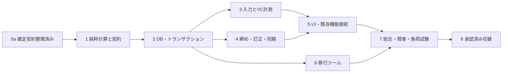

# レベリング改修 段階的実装計画

2026-11-01 / P1・P2基盤を実装・検証済み。P3以降は未着手。

## 1. 依存関係

並行可能な開発段階を表すもので、複数Botプロセス稼働を意味しない。

## 2. フェーズと完了条件

2026-11-06以降、各開発フェーズは「対象実装の完了」「必要なテスト・静的解析の成功」
「実装・テスト・設計文書・検証記録のGitコミット」のすべてを満たした時点で完了とする。
完了報告にはコミットSHA、検証結果、残課題を記載し、次フェーズ開始前に作業ツリーがcleanであることを確認する。

| 段階 | 作業・対象 | 依存／完了ゲート |
|---|---|---|
| P0 契約・運用 | DR01〜07は確定済み。0aは純粋計算契約、0bはMySQL・件数・役割・SLO・復旧窓と切替実データ確認 | 0a完了でP1開始可。0bとboost管理者確認はP7/P8までに完了。DR06はP3/P4、DR07はP5で確定契約に接続 |
| P1 Domain | 実装完了: 現行成長式維持、JST期間、倍率・端数、VC資格・最大剰余・上限、連続TOP1判定 | 純粋計算597件＋既存315件成功。環境差異と後続検証はTEST_PLAN §10 |
| P2 DB基盤 | 新モデル・Repository/DTO・Alembic追加revision、期間/イベント/receipt/pending/snapshot/監査/outbox | MySQL制約・D01〜D05/D08/D13/D15、旧schema不変、移行互換レビュー |
| P3 入力・計測 | text/action認証・重複、VC状態機械・checkpoint・照合・backoff・手動受取・上限通知 | U02/U03/U08〜U13、D02/D03/D06/D09、全VC障害マトリクス |
| P4 締め・訂正 | 独立scheduler、月末全員受取、snapshot、報酬資格、訂正preview/承認、outbox配送・role同期 | D04〜D12、訂正後続月、外部API失敗、古いjob防止、通知不明照合 |
| P5 UI・既存連携 | DBページャー・rank card・履歴Ephemeral・Components V2発表、boost管理、管理者操作、roles復元、account移行・MEE6・常駐パネル | R08〜R12/R18、UI/権限/guild_scope/registrationとDR04契約の回帰 |
| P6 移行 | expand/copy/verify/switchツール、原本台帳・再実行・バックアップ検査・rollback手順 | 移行全検証式、停止再開試験、旧TOPロール保持、新書込み後データ保護 |
| P7 統合 | 宣言環境で全検証、MySQL競合、コピーDB dry-run、専用Guild、負荷・復旧試験 | TEST_PLAN全ケースの記録、性能SLO、重大不具合0、DR未解決0 |
| P8 切替 | メンテナンス・原本保全・新schema適用・コピー・全件照合・新Bot起動 | 運用承認、実施ログ、停止時間無加算、初回境界と月末監視。旧表削除は別案件 |

P2/P3の途中版を本番有効にしない。新旧の計上ルート混在は二重加算・欠落を招く。既存feature flagで機能単位の停止はできるが、新DBへの切替はinstallation generationと起動revision検査で一括管理する。

## 3. 既存不具合の対応表

[調査レポート](LEVELING_INVESTIGATION.md) G章の指摘を漏らさず追跡する。

| 調査ID | 対応 | 段階 |
|---|---|---|
| G-01 月次加算消失 | 月別キー・期間ロック・snapshot、月間表一括削除廃止 | P2/P4 |
| G-02 締め取り逃し | OPEN期間の永続状態・起動時catch-up | P4 |
| G-03 Discord失敗と集計 | commitとoutbox分離、API失敗で結果不変 | P4 |
| G-04 ロストアップデート | DB行ロック/UQ、単一プロセス内非同期競合を検証。複数Bot計測は対象外 | P2/P3 |
| G-05 MEE6再取込み | DR04互換契約に従う永久取込み台帳・差分承認・入力検証 | P0/P5 |
| G-06 数量検証 | DR03、全経路で共通検証・overflow拒否 | P1/P2 |
| G-07 action認証 | 許可Bot ID・指定channel・message receipt | P3 |
| G-08 通知で同期中断 | 昇格通知とrole同期を独立job化 | P4 |
| G-09 古いrole同期 | 最新希望generation確認・ユーザー単位同期 | P4 |
| G-10 VC時間誤差 | 実秒数・保存状態・不明時間除外・付与seq | P3 |
| G-11 未受取月次整合 | 獲得時powerと受取meter分離、月末自動受取 | P3/P4/P6 |
| G-12 V2移行順序 | 新ツールでschemaとデータ分離、旧スクリプト流用禁止。旧V2利用を続ける場合は別修正が必要と明示 | P6 |
| G-13 boost不連続 | 新式・時間区間、DR02一覧の管理者確認（自動変換なし） | P1/P6 |
| G-14 監査不足 | 90日event、永久訂正・claim・移行台帳 | P2/P5 |
| G-15 全件取得等 | DBページング・索引・batch・負荷試験 | P2/P5/P7 |
| G-16 月間なしrank | 恒常基準でカード表示、power欠損0 | P5 |
| G-17 role整合 | 設定変更／account移行後の希望状態再計算、DR04の契約 | P4/P5 |
| G-18 メモリ・panel | cooldown/lockの非使用エントリ掃除を入れ、保持中lockを削除しない。旧panel再利用問題は共通基盤の別改善候補、今回回帰で悪化させない | P3/P5 |
| G-19 責務・未使用設定 | domain/service/repository分割、特別role設定を正規使用、50%経路廃止 | P1〜P5 |
| G-20 検証不足 | 新計画・宣言環境・MySQL競合と障害試験 | P7 |
| G-21 過去通知で付与停止 | 獲得可能量と通知済み状態を完全分離 | P3 |

## 4. 設定・文書・運用変更の実装時タスク

READMEを確認済み。現在の倍率説明は旧式であり、実装時に「加算率」と例を更新する。設定例・機能一覧・ディレクトリ説明・migration手順も同一実装リリースで更新する。P1は既存実行経路を変えないため、READMEの現行仕様説明は維持する。

config追加項目、旧voice_xp_limitの移行、TOP1/TOP10復元除外、エラー通知先、運用Guildとinstallationの一致を確認する。DB schemaはAlembic管理を維持しstartup create_tableを追加しない。権限・UI・DB・ログ・テスト・型の各専門スキルを実装段階でも適用する。

運用メトリクス: 最終checkpoint時刻、VC停止人数、未締め期間数、月末tx時間、outbox待機／needs_attention／unknown、移行検証差分、DB容量。障害履歴の専用DBは増やさない。

## 5. 今回の設計完了と実装開始の区別

設計完了条件は6文書が揃い、R01〜R20が設計・テストへ追跡でき、重要未決定事項・非保証・移行保護が明記されていること。DRの回答や本番実証は設計資料の完成とは分ける。P1実装開始条件はP0の0a（純粋計算契約）を満たし、別途実装の指示があること。全実装をDR06/DR07や本番調査の完了まで一律停止させない。今回はP1の独立domainとテストのみ実装し、DB schema変更・依存更新・本番操作は行わない。

## 6. レビュー後の開始可能範囲

**ユーザー指示によりP1のみ実装する。** 対象は現行成長式同値化、Decimal範囲検証、JST暦、倍率時間積分、floor、最大剰余、VC資格、独立上限、連続TOP1の純粋関数と値オブジェクト。DB・Discord・遅延受付方針を引数から分離する。DR06の全期間確定後付与は受理結果を明示して計算し、DR07のコマンド変更はP5に限定する。

| 段階 | レビューで追加された完了条件 |
|---|---|
| P2 | DB §3のゲート／固定順、§7の正本切替と作業表回収、§8の容量式、永久operation/import台帳 |
| P3 | checkpoint CAS、永続grant seq、prepared_random、消費位置と付与の原子更新。V02/V03/V06/V07。決定済みDR06の受付方針を接続 |
| P4 | snapshot正本から訂正、月末排他ゲート、immutable発表partとUNKNOWN停止・照合。V04/V08/V09 |
| P5 | DR04の既存コマンド・MEE6・account移行の維持、監査と帰属の回帰試験。決定済みDR07に従い安全なpreview／未完了締め再実行へ置換 |
| P6〜P8 | boost一覧と確認記録、旧成長不一致停止、容量・正本移行検査、UNKNOWNを保持した復旧演習。V05/V10〜V14 |

レビューで解消した事項: DR01〜05の方針、ロック階層の曖昧さ、正本不明と不要な作業表永久保持、VC epoch切替時の二重キー、POST不明を通常retryへ戻す危険。DR06/DR07も決定済みで、残る重要仕様判断はない。実MySQL・Discordを使った競合／障害試験は実装フェーズのゲートであり、設計レビューで実証済みとは記載しない。

## 7. P1完了とP2引継ぎ（2026-11-01）

純粋計算9モジュールと契約テスト5ファイルを追加し、実行経路・DB・依存関係は変更していない。変更文書は要件・アーキテクチャ・DB設計・移行設計・テスト計画・本計画の6点。READMEの現行コマンド仕様は確認のうえ維持した。新規597件／全912件成功、全体Ruff・Pyright成功。実行環境差異はTEST_PLAN §10を参照。

P2へ進むための純粋計算契約は揃った。P1完了時点ではP2未着手だった。P2開始時の課題として宣言Python・SQLAlchemy等の環境差異を解消し、DB §11の合算率snapshotの正確な保存、全書込み先の範囲検査、原子性・CAS・MySQL競合検証を実施する。依存関係の更新は今回未実施。

発見した注意点は、現行減算の昇格回数の独特な返却契約と、個別率と合算率snapshotの数値範囲の違い。前者は互換試験で固定、後者は整数文字列保存の技術判断をDB §11へ明文化した。業務仕様の未決定事項は増やしていない。

## 8. P2完了とP3引継ぎ（2026-11-01）

DBモデル35表、Repository/DTO、独立Alembic revision、原子処理・CAS・再試行・commit不明照会・snapshot訂正・保持回収を実装。隔離MySQL 56件を含む全体968件とRuff/Pyrightが成功した。詳細は[実装・検証記録](LEVELING_P2_REPORT.md)。

P3では同一DBのwriterへ共通MutationGateを注入し、実イベントの認可・運用Guild制約、VC照合とdrainを実装する。今回のRepositoryを既存Botへ接続していない。本番切替・旧データ移行・実Discord操作は別フェーズとして残す。
