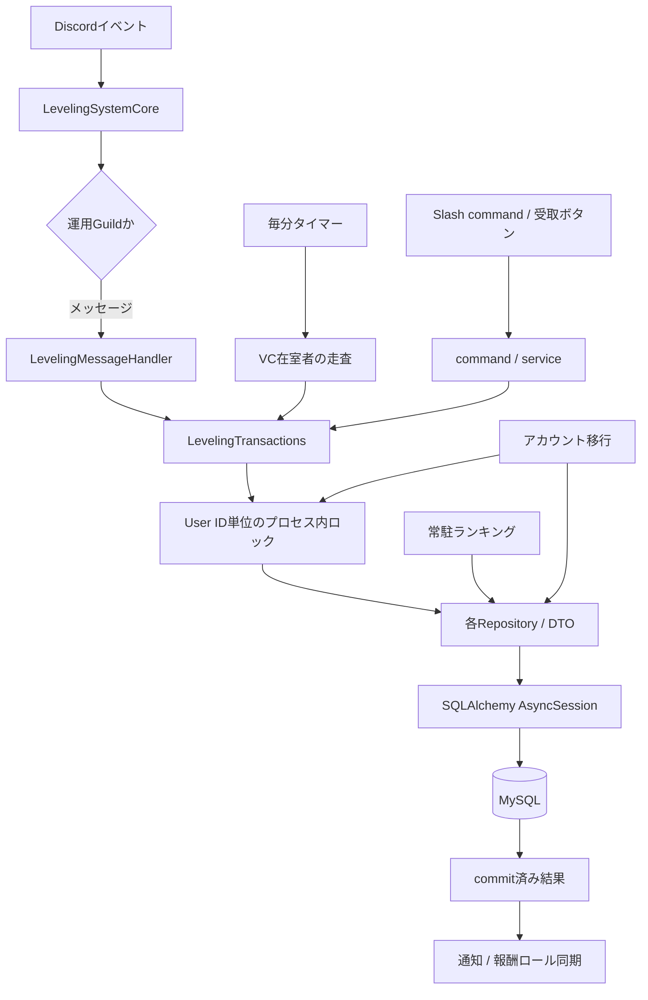
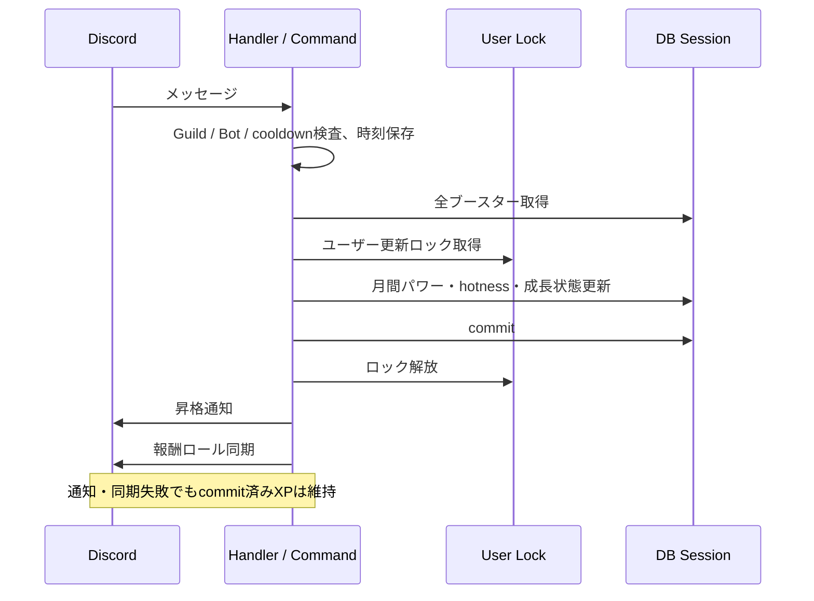
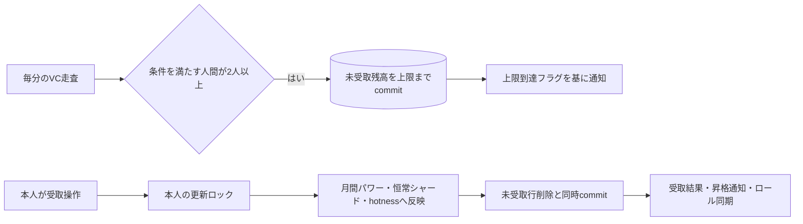

# Discord Bot レベリングシステム既存実装調査

調査日: 2026-10-30（Asia/Tokyo）\
対象コミット: `db06945028f3439eeeb68b662e281573c7e153c0`

本書は現行実装の調査結果であり、新システムの仕様決定・実装提案の確定版ではない。調査開始時の作業ツリーに変更はなかった。調査ではコード・設定・依存関係・マイグレーションを変更せず、本書だけを追加した。本番DB、Discord、MEE6への接続は行っていない。実運用の `config.yaml`、認証情報、個人データは読み取っていない。

「実装済み」はコード上に経路が存在することを意味し、本番で有効・正常稼働していることまでは意味しない。「未実装」はリポジトリ全体の検索と関連経路の追跡で実装が見つからなかったもの。「確認不能」は実設定・本番データ・外部実装・実運用の確認が必要なものを指す。問題点の「コード上確定」と「潜在リスク」も区別する。

## A. エグゼクティブサマリー

現行システムには、恒常的な成長指標である **シャード → グレード → プレステージ** と、月次集計される **テキスト／ボイス／アクションパワー** がある。一般的な「累積XPとレベルだけのシステム」ではない。メッセージは即時反映、VCは毎分の在室者サンプリングで未受取残高を保存し、本人の受取操作で成長値と月間パワーに移す。直近24時間の急上昇ランキングは、主にパワーの正の獲得イベントを集計している。[メッセージ処理][message]、[VC定期処理][voice]、[受取トランザクション][claim-tx]、[hotness集計][hotness]

設計変更前に特に注意すべき結果は次のとおり。

- **運用対象は一つのGuild。** イベント・コマンドにGuild制約がある一方、成長・パワー・未受取XPのDBキーはUser IDのみ。複数Guildのデータ分離は未実装。[Guild制約][scope]、[成長モデル][star-model]
- **主要な複合DB更新は一つのセッションでcommitされる。** ユーザー単位のプロセス内ロックと月次削除との排他も存在する。ただし、複数プロセス・外部書込みへの保護やイベントの永続的な重複排除ではない。[トランザクション][transactions]、[ロック][locks]
- **月次集計にはデータ境界上の問題がある。** 順位取得・Discord処理・削除が別段階で、集計後に増えたパワーが結果に含まれないまま削除され得る。実行済み月の保存や停止中の追いつき処理もない。[月次処理][monthly]
- **DB確定と通知・ロール同期は別処理。** XPは通知失敗で戻らない。通知例外によって後続ロール同期が実行されない経路がある。[メッセージ処理][message]、[受取副作用][claim-effects]
- **自然加算と管理者加算には統一された上限検証がない。** `set` とアカウント移行には検証があるが、通常加算・MEE6移行には同等の検証がない。DB型の範囲を超える場合の実際の結果は本番MySQL設定に依存する。[状態検証][state]、[管理者加算][admin]、[成長モデル][star-model]
- **既存の関連テスト183件は成功。** ただし既存仮想環境は宣言された最低バージョンと一部不一致であり、MySQL実環境、VC条件の組合せ、通常メッセージのクールダウン境界、複数プロセス競合の保証にはならない。詳細はH章。

## B. 関連ファイル一覧

### 機能・入力・表示

| ファイル・根拠 | 主要クラス／関数 | 役割 |
|---|---|---|
| [app/features/leveling/cog.py:30][cog] | `LevelingSystemCore`, `register_leveling_feature`, `setup` | listener、4種類の定期処理、永続受取View、コマンド登録 |
| [app/features/leveling/message_handler.py:18][message-line-18] | `LevelingMessageHandler.handle`, `_calculate_boost`, `_try_action_power_command` | メッセージXP、メモリ内クールダウン、Bot連携入力 |
| [app/features/leveling/action_power.py:8][action] | `parse_action_power_command` | `AddActionPower` の解析 |
| [app/features/leveling/domain/math_calculation.py:1][math] | `calculation_shard`, `calculation_grade`, `calculation_prestige`, `total_shard_amount` | 成長・減算・進捗の純粋計算 |
| [app/features/leveling/domain/boost_duration.py:10][duration] | `parse_boost_duration` | ブースター期間文字列の解析 |
| [app/features/leveling/service.py:22][claim-service] | `claim_voice_xp_rewards`, `apply_voice_xp_claim_side_effects` | VC受取と通知／ロール同期の接続 |
| [app/features/leveling/manage_reward_role.py:11][roles] | `get_member_grade_roles`, `get_member_prestige_roles`, `sync_grade_prestige_role` | 到達値から報酬ロールの追加／削除を計算・実行 |
| [app/features/leveling/build_send_message.py:72][presentation] | `send_grade_up_message`, `send_prestige_up_message`, `send_prestige_announce`, `build_rank_view`, 各ランキングbuilder | Embed、Components V2、進捗・順位表示 |
| [app/features/leveling/views.py:13][views] | `ClaimVoiceXPButton.callback`, `ClaimVoiceXP` | 永続受取ボタン |
| [app/features/leveling/setup_command.py:18][setup] | `claim_voice_xp_button` | 管理者による受取パネル設置 |
| [app/features/leveling/commands/command.py:30][commands] | `claim_voice_xp`, `rank`, `transfer_mee6` | 本人受取、ランクカード、旧XP取込み |
| [app/features/leveling/commands/shard_command.py:24][shard-commands] | `top`, `xp_boost`, `reward_grade`, `reward_prestige` | 恒常順位・ブースター・報酬一覧 |
| [app/features/leveling/commands/power_command.py:19][power-commands] | `top` | 月間順位一覧 |
| [app/features/leveling/commands/admin_groups.py:8][admin-groups] | `leveling_admin_group`, `admin_shard_group`, `admin_power_group` | 管理者コマンドの階層・権限メタデータ |
| [app/features/leveling/commands/admin_command.py:25][admin] | `xp_boost_add/delete`, `add/remove_shard`, `add/remove_power`, `aggregate_power_ranking`, `action_power_total` | 管理者操作 |
| [app/features/leveling/commands/set_command.py:19][set-commands] | `set_shards`, `set_powers` | 種類別残高の絶対値設定 |
| [app/features/leveling/commands/pending_command.py:18][pending] | `set_pending` | 未受取XP・通知フラグの絶対値設定 |
| [app/features/leveling/monthly.py:54][monthly] | `run_monthly_ranking`, `build_monthly_ranking_views` | 月間報酬、結果送信、月間状態削除 |
| [app/features/leveling/ranking_board.py:21][board] | `RankingBoardPanel.render/refresh/initialize` | 恒常・月間・急上昇TOP3の常駐パネル |
| [app/features/leveling/messages/ranking.py:10][ranking-copy] | `rank_card`, `hotness_ranking_description` など | 順位表示文言 |
| [app/features/leveling/messages/progression.py:3][progression-copy] / [voice_xp.py:3][voice-copy] | 昇格・受取文言 | 通知本文 |
| [app/features/leveling/messages/admin.py:1][admin-copy] / [rewards.py:1][rewards-copy] / [restore.py:1][restore-copy] / [mee6.py:1][mee6-copy] / [common.py:1][common-copy] | 定数・書式関数 | 管理、報酬、復元、取込み、共通表示 |

### 永続化・共通基盤・連携

| ファイル・根拠 | 主要クラス／関数 | 役割 |
|---|---|---|
| [app/database/repositories/leveling.py:43][transactions] | `LevelingTransactions` | 複数テーブルを更新するユースケース単位のトランザクション |
| [app/database/repositories/leveling_locks.py:8][locks] | `LevelingLocks.user_updates`, `_monthly_power_reset` | ユーザー更新・月次リセットのプロセス内排他 |
| [app/database/repositories/star_grades.py:32][star-repo] | `StarGrades`, `StarGradeData`, `StarGradeRankingData` | 成長状態の取得・加減算・順位 |
| [app/database/repositories/monthly_powers.py:30][power-repo] / [monthly_action_powers.py:56][action-repo] | `MonthlyPowers`, `MonthlyActionPowers` | 月間パワー、合算順位、全体合計、削除 |
| [app/database/repositories/voice_xp_limits.py:24][pending-repo] | `VoiceXPLimits`, `_apply_limit` | 未受取残高、上限、通知済み状態 |
| [app/database/repositories/xp_boosts.py:21][boost-repo] | `XPBoosts` | ロール別倍率、上書き、期限切れ削除 |
| [app/database/repositories/leveling_hotness.py:32][hotness] | `LevelingHotness` | 時刻付き正の獲得イベント、24時間集計・削除 |
| [app/database/leveling_state.py:7][state] / [repositories/leveling_state.py:14][state-repo] | `ShardState`, `PowerState`, `LevelingStateRepository` | 上限検証、種類別合計から進行度を再構成 |
| [app/database/models/star_grades.py:11][star-model] ほかF章の6モデル | 各ORMモデル | 型・主キー・索引・デフォルト |
| [app/database/repositories/__init__.py:19][repositories] / [manager.py:10][manager] / [session.py:28][session] | `DatabaseRepositories`, `DatabaseManager`, `create_session_factory` | Repository集約、async session、接続管理 |
| [app/core/config.py:112][config] / [config.example.yaml:63][config-example] | `LevelingConfig`, `GradeRoleReward`, `PrestigeRoleReward` | 一つの運用Guild向け設定 |
| [app/core/bot.py:25][bot] / [extensions.py:11][extensions] / [launch_app.py:60][launch] | `AsteroidBot.setup_hook`, `iter_enabled_extensions`, `main` | DB revision確認、機能フラグ、起動 |
| [app/common/guild_scope.py:36][scope] / [permissions.py:9][permissions] / [command_groups.py:22][registration] | `OperatingGuildCommandTree`, `GuildScopedLayoutView`, `admin_only` | Guild制約・権限・登録 |
| [app/common/persistent_panels.py:86][panels] / [layout_pages.py:1][pages] | `PersistentPanelManager`, `LayoutPaginator` | 常駐表示と一時ページャー |
| [app/common/error_reporting.py:90][errors] / [interaction_errors.py:62][ui-errors] / [features/log/error.py:61][command-errors] | バックグラウンド・UI・コマンドエラー処理 | 例外記録・利用者へのエラー応答。XP補償処理ではない |
| [app/features/account_migration/service.py:94][migration-service] / [discord_state.py:74][migration-discord] | `MigrationService.execute`, `DiscordMigration.apply/rollback` | アカウント間の移行、Discord変更、失敗時復元 |
| [app/database/account_migration.py:40][merge] / [repositories/account_migration.py:23][migration-repo] | `merge_leveling`, `AccountMigrationRepository` | 残高合算・旧アカウントゼロ化・hotness所有者変更 |
| [app/features/roles/service.py:37][join-roles] / [cog.py:20][join-events] | `save_user_roles`, `restore_user_roles` | 報酬ロールも設定次第で退出時保存・再参加時復元の対象 |
| [scripts/v2_to_v3_migration.py:250][v2-script] | `migrate`, `dump_source_data`, `import_dump` | V2データのSQLダンプ移行。今回未実行 |
| [app/database/migrations_check.py:62][revision-check]、F章のmigration群 | `ensure_database_revision_is_current`, 各`upgrade/downgrade` | schema履歴・起動前検査 |

検索対象は `app` 全体、`scripts`、`tests`、README、設定例、起動・依存関係・Docker定義、全migration。starboardの星、誕生日、bump、VC作成などからレベリングDBへ直接XPを加算する経路は見つからない。外部Botがアクションパワー入力を生成している可能性はあるが、その実装は本リポジトリにない。共有メッセージキャッシュはstarboard等も利用するが、それ自体はXPの重複防止機構ではない。[キャッシュ][cache]、[アクション入力][action-input]

## C. 現行機能一覧

| 機能 | 判定 | 現状・根拠 |
|---|---|---|
| メッセージXP | 実装済み | 乱数、User ID単位クールダウン、即時DB反映。[handle][message] |
| VC滞在XP | 実装済み | 毎分サンプリング、条件を満たす2人以上、未受取残高へ保存。[voice_xp_claim][voice] |
| VC実滞在秒数の計測 | 未実装 | 入退室時刻・参加セッション・積算時間を保存しない。[voice_xp_claim][voice] |
| Bot連携のアクションパワー | 実装済み | 指定チャンネルのBot投稿を解析。シャードは増えない。[action入力][action-input] |
| リアクション・招待・誕生日等による直接XP付与 | 未実装 | 全体検索で付与経路なし。外部Bot側の独自報酬は確認不能 |
| グレード／プレステージ、複数段階上昇・減算 | 実装済み | 数式・繰返し計算・下限0。[calculation_shard][math] |
| 全経路共通の最大成長値制御 | 未実装 | `set`・移行には上限があるが通常加算にはない。[state][state]、[transactions][transactions] |
| クールダウン以外の文章スパム検知 | 未実装 | 文字数、内容重複、添付、連投内容、同一message IDの検査なし。[handle][message] |
| ロール別ブースト | 実装済み | ロールごとの倍率合計からボーナスシャードを計算。[boost][boost-calc] |
| チャンネル・ロール別の通常XP除外設定 | 未実装 | Guild以外の一般的な許可／除外リストなし。VCテキストの倍率調整のみ。[config][config] |
| 昇格通知／報酬ロール | 実装済み | 発生チャンネル、追加のプレステージ通知先、到達値ロール同期。[通知][presentation]、[同期][roles] |
| 全員への定期的な報酬ロール再同期 | 未実装 | 通常メッセージ報酬、VC受取、管理者シャード操作等の時点で同期 |
| 恒常・月間ランキング／ランクカード | 実装済み | SQLの`RANK()`、全件ページング、個人順位。[star][star-ranking]、[power][power-repo] |
| 直近24時間ランキング | 実装済み | 正のパワー獲得履歴をSUM、TOP3。[hotness][hotness] |
| 月次報酬・リセット | 実装済み | TOP1/TOP10ロール、結果表示、全月間残高削除。[monthly][monthly] |
| 過去月アーカイブ・月次実行済み記録 | 未実装 | 月識別子・集計済み月・月次結果テーブルなし |
| 管理者加減算・絶対値復元 | 実装済み | シャード、パワー、未受取状態。[管理][admin]、[set][set-commands]、[pending][pending] |
| 管理者の直接グレード／プレステージコマンド | 未実装 | Repository計算APIはあるが登録されたSlash commandはない |
| MEE6取込み／アカウント移行 | 実装済み | 別の経路として存在。冪等性・移行範囲が異なる。[MEE6][mee6]、[migration][migration-service] |
| 複数Guild独立運用／Guild別DB設定 | 未実装 | 一つの`discord.guild_id`とGuild列のないDB |
| 実際の有効設定・データ件数・ロール権限・DB状態 | 確認不能 | 実設定と本番環境を参照していない |

## D. 現行仕様

### D.1 用語と保存値

| 用語 | 実装上の意味 |
|---|---|
| `shard` | **現在グレード内の余剰XP**。累積総XPではない |
| `text_shard`, `voice_shard`, `bonus_shard` | 種類別の累積残高。管理者減算で減るため、削除不能な生涯獲得履歴ではない |
| `grade` | 0〜49の周回内レベル |
| `prestige` | 50グレードごとの周回数 |
| `text_power`, `voice_power`, `action_power` | 月間ランキング用残高。恒常シャードとは別に保存 |
| 未受取XP | `voice_xp_limits`に保存されたシャード2種とボイスパワー |
| hotness | 直近24時間に記録された正のパワー獲得量の合計 |

根拠: [計算関数][math]、[モデル][star-model]、[メッセージ反映][message-tx]、[VC受取][claim-tx]、[hotness記録][hotness]。

### D.2 設定値

以下は**クラス既定値と設定例**であり、実運用値ではない。[LevelingConfig][config]、[設定例][config-example]

| 項目 | 既定値 |
|---|---:|
| メッセージクールダウン | 15秒 |
| メッセージ基本XP | 10〜25の整数乱数 |
| VCの毎分基本XP | 10〜25の整数乱数 |
| `voice_xp_adjust` | 0.3 |
| 未受取VC上限 | 300 |
| グレード報酬の重ね付け | false |
| プレステージ報酬の重ね付け | true |
| 報酬ロール一覧 | 空リスト |
| 各通知・ランキング・アクション入力チャンネルID | 0 |
| TOP1/TOP10ロールID | 0 |

`true_top_ranker_role_id`は設定フィールドのみで、利用箇所は見つからない。数値設定には、非負・min≦max・倍率の妥当性などの専用検証がない。Pydanticの型検証と未知キー拒否はある。設定は起動時に読み込み、`reload_config()`は定義されているが呼出し元は見つからない。[config.py:14,112,202][config-base]

### D.3 メッセージ経験値

処理順序は `LevelingSystemCore.on_message` → `LevelingMessageHandler.handle`。

1. 対象Guild以外・DMを除外する。
2. 共有メッセージキャッシュに保存する。
3. Bot連携の`AddActionPower`を先に試す。
4. 通常XPではBotと`discord.Member`以外を除外する。
5. `cooldown[user_id] + message_cooldown >= time()`なら加算しない。
6. 加算可能なら**DBアクセス前**に現在時刻をクールダウンへ記録する。
7. 基本XP、ブーストを計算してDB更新をcommitする。
8. 昇格通知、追加のプレステージ通知、報酬ロール同期を順に実行する。

根拠: [cog.py:50][message-entry]、[message_handler.py:23][message]。

通常のテキストチャンネルで基本乱数を `r` とすると、テキストパワーとテキストシャードがそれぞれ`r`増える。VCのテキスト欄では、`channel.type == voice`のとき `r = int(r × voice_xp_adjust)` としてから同じ**テキスト**指標へ加算する。既定値ではVCテキストの基本加算は3〜7。StageChannelへの同じ倍率分岐はない。[message_handler.py:39][message-line-39]

通常XPについて、管理者の特別扱い、除外ロール、除外チャンネル、文章長・添付の条件、メッセージ内容の重複検知はない。Webhook専用判定`webhook_id`もない。通常WebhookがBot／非Memberとして表現される場合は通常XP経路で除外されるが、Bot連携経路についてはD.6の条件が先に適用される。編集・削除イベントによる追加XP・返還処理はない。

クールダウンはGuild・チャンネルを含まないUser ID単位。期限ちょうどもスキップし、スキップ時には期限を延長しない。同一イベントループ内では判定から時刻保存まで`await`がないため、通常メッセージ同士の直近並行処理を抑止する。一方、再起動で消え、メッセージIDによる永続重複排除はなく、DB失敗でもその時刻は残る。[message_handler.py:21,31][message]

### D.4 ブースト計算

対象ユーザーの保有ロールに一致するブースターについて、

```text
s = Σ(boost_amount / 100)
m = s + 1  （s < 1 の場合）
m = s      （s >= 1 の場合）
bonus = int(base × m) - base
```

を計算する。`bonus > 0`の場合のみボーナスシャードとして追加する。基本パワーはブーストされない。[メッセージ倍率計算][boost-calc]、[メッセージ反映][message-tx]

| 設定例 | 計算上の合計倍率 |
|---|---:|
| 該当ロールなし／0% | 1倍 |
| 50%を一つ | 1.5倍 |
| 99%を一つ | 1.99倍 |
| 100%を一つ | 1倍 |
| 200%を一つ | 2倍 |
| 100%を二つ | 2倍 |
| 200%を二つ | 4倍 |

上表はコードの式から導いた値である。特に100%未満の扱いは「そのまま倍率」とは一致しないが、この扱いが意図的かは確認不能。READMEが明示する100%・200%の例自体は実装と一致する。[README.md:62][readme-boost]

ブースターはRole IDを主キーとして上書きされる。期間は`w/d/h/m/s`の整数と複合指定を受け付け、省略すると無期限。期限はUTCのnaive datetime。**適用時のSELECTには期限条件がない**ため、毎分の期限切れDELETEが実行されるまでは期限切れ倍率も使われる。[期間解析][duration]、[管理登録][admin]、[XPBoosts.get_xp_boosts/delete_expired_xp_boosts][boost-repo]

### D.5 VC経験値・受取

`voice_xp_claim`という名前の定期処理は、本人による受取ではなく、**毎分の未受取XP蓄積処理**である。[cog.py:60][voice]

- 対象Guildの`guild.voice_channels`を走査する。StageChannelはこの列挙対象ではない。
- Botを除外し、`member.voice`が存在し、`mute/deaf/afk/self_mute/self_deaf`がすべてfalseのメンバーを抽出する。
- **抽出後に2人以上**いるチャンネルだけが対象。人間1人＋Bot、発言可能な人間1人＋ミュート中の人間では不足する。
- 管理者は一般ユーザーと同じ扱い。AFKチャンネルIDそのものの比較はなく、`voice.afk`を検査する。実発話、カメラ、配信の有無は見ていない。
- 各メンバーごとに毎回別の乱数を引く。入室イベント、退出イベント、滞在開始時刻、経過秒数は使用しない。

基本乱数`r`、調整係数`a`、D.4の倍率`m`に対し、

```text
voice_power増分 = int(r × a)
voice_shard増分 = int(r × a)
bonus_shard増分 = int((int(r × m) - r) × a)
```

となる。メッセージ側は調整後の値に倍率を適用するため、丸め順序が違う。例として`r=15, a=0.3, m=1.5`なら、VC蓄積の合計シャードは`4+2=6`。[cog.py:87][voice-line-87]

上限は「ボイスパワー」と「ボイスシャード＋ボーナスシャード」の**二つに個別適用**される。日次上限ではなく、受取までの蓄積上限である。パワー、基本ボイスシャードの順に加算し、返された`full_notify`がfalseかつボーナスが正ならボーナスを加算する。上限超過分は切り捨てられる。両系統は同じ`half_notify/full_notify`フラグを共有し、いずれかが半分／上限に達したことを保存する。過去にtrueになったフラグも判定へ持ち越される点に注意が必要（G-21）。[accrue_voice_xp][accrue-tx]、[VoiceXPLimits._apply_limit][pending-limit]

フラグがfalse→trueへ変わった回で通知判定を返す。上限通知はそのVCのテキスト欄へ送る。半分到達の検出・フラグ保存は実装済みだが、`voice_half_limit_reached_send()`は即時returnし、**通知本文の送信は未実装**。通知フラグは送信前のcommitで保存される。[cog.py:111][voice-line-111]、[cog.py:132][half-notice]

本人が`/claim_voice_xp`またはボタンを押すと、User IDに紐づく未受取分をまとめて受け取る。押した時点の在室、ミュート、人数、ボタンの設置先チャンネルへの所属は問わない。表示された特定ユーザーの残高ではなく、常に**操作した本人**の残高を対象にする。[commands/command.py:30][commands]、[views.py:22][views-line-22]

受取の一つのDBトランザクションで、ボイスパワーを月間値へ、ボイス／ボーナスシャードを成長値へ加算し、ボイスパワー分をhotnessへ記録して、未受取行を削除する。残高がない／合計0なら加算しない。受取後は再び上限まで蓄積できる。[claim_voice_xp][claim-tx]

再起動してもcommit済み未受取分は残る。一方、停止時間・サンプリング間の在室時間を後から計算する実装はない。短時間入室でも走査瞬間に条件を満たせば1回分を得られ、走査間で入退出を完結すると得られない。これはコード上の時間モデルであり、実滞在分数の厳密な測定ではない。

### D.6 その他の獲得・移動

**アクションパワー連携:** 対象Guild・設定チャンネル・`author.bot=True`の投稿に対し、`AddActionPower <正の整数User ID> <正の整数数量> [任意の余剰文字列]`を処理する。対象がGuildのメンバーキャッシュに存在することが必要。送信BotのID許可リスト、署名、イベントID、クールダウン、数量上限はない。対象メンバーのBot除外もない。月間アクションパワーとhotnessへ追加し、成功リアクションを試みる。リアクションのHTTP例外は無視する。[parse_action_power_command][action]、[_try_action_power_command][action-input]

**管理者操作:** シャード・パワーを直接加減算する。パワーの正の加算はhotnessへ記録、減算は過去イベントを取り消さない。シャードの加算・減算はパワーやhotnessに連動しない。絶対値`set`ではhotnessを追加しない。[LevelingTransactions][transactions]、[LevelingStateRepository][state-repo]

**MEE6取込み:** 作業ディレクトリの`mee6_data.json`があればそれを読む。なければコードに固定された特定GuildのMEE6 endpointへ`limit=500`で一度だけ取得し保存する。ページング・取込済み印・既存値との照合はない。在籍者はXP量によらず、非在籍者はXPが13,800以上なら対象となる。保有している設定済みプレステージ報酬ロールの**個数**を追加プレステージ数とし、MEE6 XPをテキストシャードへ**加算**する。設定thresholdの値を合算する処理ではない。ロール同期・追加通知は引数次第。再実行は同じ値を重ねて加算する。[transfer_mee6][mee6]、[apply_mee6_transfer][mee6-tx]

**アカウント移行:** 種類別シャード・パワー・未受取残高を合算し、成長を再計算、移行元をゼロ化、hotnessのUser IDを付け替える。フラグはOR。受取後まで含めた上限検証、対象2人のロック、プレビュー後の変化検査がある。Discordのロール移動は別のオプションであり、合算後の成長thresholdに基づく`sync_grade_prestige_role()`は移行処理から呼ばれない。[merge_leveling][merge]、[AccountMigrationRepository.apply][migration-repo]、[MigrationService.execute][migration-service]

### D.7 レベル計算

現在グレードを`g`、プレステージを`p`、グレード内余剰を`x`とする。

```text
次グレードに必要なXP: Q(g) = 5g² + 50g + 100
グレード0からgまでの累積: C(g) = 5(2g³ + 27g² + 91g) / 6
1プレステージ: C(50) = 268,375
総成長XP: T = 268,375p + C(g) + x
```

Python実装の`C(g)`は整数除算`// 6`。正常な状態では`0≤g≤49`かつ`0≤x<Q(g)`で、`text_shard + voice_shard + bonus_shard = T`になる。DBにこの等式を強制するCHECK制約はない。[math_calculation.py:1][math]、[StarGradeModel][star-model]

- XPを追加し、次段階の閾値を超える限りwhileループで昇格する。
- `grade >= 50`になるたびに`prestige += 1`、`grade -= 50`。
- 複数グレード／プレステージを一度に上げられる。通知は段階ごとではなく処理結果に対して一度。
- 負のXPは現在の進行度を総XPへ戻して減算し、下限0にして0から再計算する。
- 管理者の種類指定`remove`は、その種類の残高まで減算量を制限する。
- `calculation_grade`は指定後のgradeが0〜49であることを要求するが、公開Slash commandはない。
- 計算関数自体に最大prestigeはない。DBはunsigned TINYINTなのでprestigeは255まで。`set`は総量68,703,999までを許容し、通常加算はこの制限を検査していない。

根拠: [calculation_shard/calculation_grade/calculation_prestige][math]、[remove_text_shard_in_session][shard-remove]、[状態上限][state]。

メモリ内の計算確認では、`(p=0,g=49,x=14,554)+1`が`(1,0,0)`、536,750XPの一括加算が`(2,0,0)`となった。最大正常状態`(255,49,14,554)`の総XPは68,703,999。

### D.8 通知・報酬

グレード上昇だけの場合は元チャンネルに「レベルアップ！」Embedを送る。プレステージ上昇があれば、グレード通知よりプレステージ通知を優先し、設定先へ追加の達成通知を送る。本文はユーザーメンションと旧値→新値。StageChannelへの通常昇格通知はスキップする。[send_grade_up_message/send_prestige_up_message][presentation]、[文言][progression-copy]

追加のプレステージ通知は、設定された到達済み報酬のうち最高thresholdのロールメンション、またはプレステージ名を表示する。チャンネルIDが0、取得不能、対象Guild外なら送らない。[send_prestige_announce][prestige-notice]

報酬はgradeとprestigeで別々に計算する。stack=trueなら到達済みすべて、falseなら最高threshold一つを残す。未到達ロールと、stack=false時の下位ロールを剥奪する。プレステージ周回でgradeが0へ戻ると、gradeロールも現在gradeに従い再評価される。存在しないロールはスキップし、既に所持する追加対象／未所持の削除対象にはAPIを呼ばない。[get_member_grade_roles/get_member_prestige_roles][roles]

通常同期は`add_roles/remove_roles(atomic=False)`。付与可能性・managed role・Botのロール階層の事前検証はなく、API失敗は呼出し元へ伝播する。DB commit後の通知が先に失敗した場合、同期まで到達しない。`set_shards`だけは同期のHTTP例外を捕捉し「設定は完了したが同期失敗」という応答へ進む。[sync_grade_prestige_role][role-sync]、[set_shards][set-commands]

設定変更後に全員へ自動再適用する処理はない。次の報酬処理などで再評価される。設定一覧から消した旧報酬ロールは、その一覧を基準とする削除対象にも現れなくなるため、自動剥奪されない。ブースター変更は以後の取得・走査へ適用され、確定済み／蓄積済み数量を再計算しない。

### D.9 コマンドと権限

すべて共有CommandTreeで運用Guildに制限される。管理者操作には`admin_only`による`administrator=True`の実行時検査がある。ボタンは`GuildScopedLayoutView.interaction_check`を継承する。[Guild制約][scope]、[admin_only][permissions]

| コマンド | 利用者 | 機能・応答 |
|---|---|---|
| `/rank [ユーザー]` | 一般 | 自分／指定Userの恒常・月間順位、3種類のシャード・パワー、進捗を公開表示。月間値がないと恒常値があってもカードを表示しない |
| `/claim_voice_xp` | 一般 | 本人の未受取分を受取。defer後に公開応答。残高なしも公開応答 |
| 受取ボタン | 一般 | 本人分を受取。成功は公開、残高なしはephemeral。DB処理前のdeferなし |
| `/shard top` | 一般 | 恒常順位の全件を5件／ページで表示 |
| `/power top` | 一般 | 月間順位の全件を5件／ページで表示 |
| `/shard xp_boost` | 一般 | 全ブースターを10件／ページで表示 |
| `/shard reward grade`、`prestige` | 一般 | 設定済み報酬ロール一覧 |
| `/leveling booster add`、`delete` | 管理者 | ロール別倍率の登録／削除。期間は任意。通常成功は公開 |
| `/leveling shard add`、`remove` | 管理者 | 種類別加減算、成長再計算、報酬同期。通常成功は公開 |
| `/leveling power add`、`remove` | 管理者 | 種類別月間パワーの加減算。通常成功は公開 |
| `/leveling shard set` | 管理者 | 3種類を絶対値で保存、成長再計算、在籍者の報酬同期。ephemeral |
| `/leveling power set` | 管理者 | 3種類を絶対値で保存。hotnessに追加しない。ephemeral |
| `/leveling pending set` | 管理者 | 未受取3数量と通知フラグの上書き。ephemeral |
| `/leveling power aggregate [データ削除=False]` | 管理者 | 強制月次集計。結果はephemeralだが、報酬ロール・結果チャンネルには副作用あり |
| `/leveling action_power_total` | 管理者 | 月間アクションパワー全体合計。ephemeral |
| `/setup claim_voice_xp_button` | 管理者 | 現在チャンネルへ永続パネル設置。操作結果はephemeral |
| `/setup transfer_mee6` | 管理者 | MEE6取込み。ロール同期／通知のbool引数。公開進捗・結果 |
| `/migrate` | 管理者 | 別機能のアカウント移行。プレビューと確認操作を経て実行 |

根拠: [基本コマンド][commands]、[シャード群][shard-commands]、[パワー群][power-commands]、[管理者群][admin]、[set][set-commands]、[pending][pending]、[setup][setup]、[移行サービス][migration-service]。

`remove`は1以上、`set`は非負と上限を検証する。`add`の数量・ブースター倍率はplain `int`で、同等の範囲検証がない。直接のレベル設定コマンドはなく、シャード絶対値から再計算する。[admin_command.py:118,157,197,222][admin]、[set_command.py:30][set-commands-line-30]

### D.10 ランキングと月次処理

- **恒常順位:** `prestige DESC, grade DESC, shard DESC`の`RANK()`。同値は同順位で次順位が飛ぶ。全件取得時の同値内順序にはUser IDの明示的な順序指定がない。[StarGrades._ranking_subquery/get_star_grade_ranking][star-ranking]
- **月間順位:** 月間テキスト／ボイス表とアクション表のUser IDをUNIONし、外部結合して欠損を0にする。3値合計の`RANK()`。表示順は合計降順、User ID昇順。月のカラムや日付フィルターはなく、最後のリセット以後の残高である。[MonthlyPowers._aggregated_subquery][power-repo]
- **急上昇:** `earned_at >= now(UTC)-24h`をUser ID別SUMし、量降順、User ID昇順、3件。正の基本メッセージパワー、受取時のボイスパワー、Bot連携・管理者パワー加算が対象。ボーナスシャード・シャード直接操作・`set`は対象外。VCの活動時刻ではなく**受取時刻**になる。[hotness][hotness]、[transactions][transactions]
- **Guild在籍フィルター:** いずれのSQLにもない。退出者の残高も順位を占める。表示用のユーザーキャッシュがなければ不明ユーザー表示となる。[表示builder][presentation]、[star順位][star-ranking]、[power順位][power-repo]
- **常駐パネル:** 毎分3種類のTOP3を並行取得して編集する。値が同じ場合の編集抑止はない。[RankingBoardPanel.render][board]、[PersistentPanelManager._publish][panel-publish]

月次ループは毎日JST 00:00に起動し、`run_monthly_ranking()`内でOSローカル時刻の「1日00:00」を検査する。Dockerfileは`TZ=Asia/Tokyo`だが、他の起動環境のTZは確認不能。[cog.py:56][monthly-entry]、[monthly.py:62][monthly-line-62]、[Dockerfile:23][docker]

処理は「上位10行を取得 → 順位1の在籍者へTOP1ロール追加 → 上位10行の在籍者へTOP10ロール追加 → それ以外の旧TOP10所持者から剥奪 → 結果を3メッセージ送信 → アクションパワー合計送信 → 月間状態削除」。旧TOP1ロールを剥奪する処理はない。同率1位が複数なら取得された範囲内で全員に付与する。上位10**順位**全員ではなく10**行**が対象で、退出者を除外して11行目以降を補充する処理はない。[run_monthly_ranking][monthly]

削除対象は`monthly_powers`全行、`monthly_action_powers`全行、`voice_xp_limits.voice_power`のみ0。恒常シャード、未受取シャード2種、通知フラグ、hotnessはこのリセットでは消さない。したがって月末の未受取ボイスパワーは受取なしで消える。[reset_monthly_power_state][reset]、[reset_voice_power_in_session][pending-reset]

### D.11 ドキュメント・表示文言との照合

READMEのブースター100%／200%、同Role上書き、期間省略時の無期限化、毎分削除、数量setの再計算、power setのhotness非追加、アカウント移行の数値合算は実装と整合する。これらについて明示的な仕様矛盾は確認していない。[README:60–99][readme-boost]

一方、急上昇表示は「直近24時間の経験値獲得量」だが、実際にはボーナスシャードを含まず、管理者のパワー加算を含み、VCは受取時刻で記録する。表示だけで「活動時刻の全XP」と理解すると差が出る。READMEには100%未満のブースト、月末未受取パワーの破棄、旧TOP1ロール維持、月次実行漏れの挙動が記載されていない。本書はこれらを実装上の挙動として記録し、記載のない意図を推測しない。[hotness表示][ranking-copy]、[記録処理][transactions]、[月次処理][monthly]

## E. アーキテクチャ

### E.1 構成・依存関係

Python、discord.pyのCog／app_commands／tasks.loop、SQLAlchemy async、aiomysql、Alembic、Pydantic、ruamel.yamlを使用する。MEE6取込みはaiohttp。依存宣言はPython≥3.14.8、discord.py≥2.7.1、SQLAlchemy≥2.1.5などで、今回実行した仮想環境の実バージョンとは一部異なる。[pyproject.toml:6][dependencies]



Cogがイベント受信とVCドメイン条件、commandが一部ユースケースと表示、serviceがVC受取の後処理、Repositoryが永続化と成長状態更新を担う。純粋計算はfeature内domainへ分かれているが、DB Repositoryがfeature側の計算関数をimportする依存方向になっている。[cog][cog]、[service][claim-service]、[star_grades.py:11][star-repo-line-11]、[leveling_state.py:5][state-line-5]

### E.2 メッセージ・VCフロー





根拠: [message_handler.handle][message]、[apply_message_reward][message-tx]、[accrue_voice_xp][accrue-tx]、[claim_voice_xp][claim-tx]、[claim副作用][claim-effects]。

### E.3 キャッシュ・非同期・再起動

| 状態 | 保存先・寿命 | 更新・復旧 |
|---|---|---|
| メッセージクールダウン | Handlerの辞書 | 許可メッセージ時に保存。期限切れ削除なし。再起動・Cog再生成で消失 |
| ユーザーロック | `LevelingLocks._user_locks` | User IDごとに作成、削除なし。プロセス内のみ |
| 共有メッセージキャッシュ | Botの辞書、最大2048件 | メッセージ受信などで保存、古い挿入から除去。XP台帳ではない |
| Member/Role/Channel | discord.pyキャッシュ | `get_member/get_role/get_channel`を多用。MEE6・アクション入力等はキャッシュ不在に影響される |
| XP・残高 | DB | 加算ごとにcommit。まとめ書きキャッシュなし |
| ランキングの投稿先Message | `PersistentPanel.message` | 再起動時、チャンネル最新1件のBot投稿とマーカーを照合して再利用 |
| ブースター | DB | メッセージごとに全件取得。VCは対象Guildの1走査で一度取得 |

根拠: [message][message]、[locks][locks]、[Bot.remember_message][cache]、[panels][panels]、[最新投稿照合][panel-reuse]。

業務用キュー・永続ジョブ・イベントoutboxは未実装。VCメンバー処理は逐次await。ランキング3種のみ`asyncio.gather`で並行取得する。Cog loadで受取Viewを再登録し、unloadで4ループをcancelする。ランキング・月次・期限切れ処理にはready待機があるが、VC蓄積に登録されたフックは`before_loop`ではなく`after_loop`で、失敗時にreadyを待って再起動するもの。起動直後にGuildキャッシュが空なら初回走査は加算しない。[cog.py:30–178][cog]

## F. データ構造

### F.1 スキーマ

以下はリポジトリ定義。実DBと一致するかは確認不能。`U32`はMySQL `INTEGER UNSIGNED`、`U64`は`BIGINT UNSIGNED`。特記以外はNOT NULL。各User ID／Role IDはアプリからDiscord IDを指定する。

| テーブル | 主キー | その他のカラム | 索引・制約 |
|---|---|---|---|
| `star_grades` | `user_id U64` | `prestige TINYINT UNSIGNED`, `grade TINYINT UNSIGNED`, `shard/text_shard/voice_shard/bonus_shard U32`, `created_at/updated_at DATETIME` | `(prestige, grade, shard)`の非unique index。数量default 0 |
| `monthly_powers` | `user_id U64` | `text_power/voice_power U32`, timestamps | 数量default 0。追加indexなし |
| `monthly_action_powers` | `user_id U64` | `action_power U32`, timestamps | 数量default 0。追加indexなし |
| `voice_xp_limits` | `user_id U64` | `voice_shard/bonus_shard/voice_power U32`, `half_notify/full_notify Boolean`, timestamps | 数量0、フラグfalse。追加indexなし |
| `xp_boosts` | `role_id U64` | `name VARCHAR(100)`, `boost_amount U32`, `boost_end_time DATETIME NULL`, timestamps | `boost_end_time` index。倍率にCHECKなし |
| `leveling_hotness_events` | `id U64 AUTO_INCREMENT` | `user_id U64`, `amount U32`, `earned_at DATETIME` | `(earned_at, user_id)` index、earned_at default CURRENT_TIMESTAMP |

モデル根拠: [star_grades.py:11][star-model]、[monthly_powers.py:11][power-model]、[monthly_action_powers.py:11][action-model]、[voice_xp_limits.py:11][pending-model]、[xp_boosts.py:13][boost-model]、[leveling_hotness.py:12][hotness-model]。

全6表にGuild IDはない。外部キー、グレード0〜49のCHECK、種類別合計と進行度の整合性CHECK、元イベントIDのunique制約、楽観ロックversion列はない。User IDを主キーとする初期DDLではAUTO_INCREMENT指定もあるが、通常のRepositoryはDiscord IDを明示している。[初期migration][baseline]、[成長作成][star-create]

hotness以外はTimestampMixinで`created_at=CURRENT_TIMESTAMP`、`updated_at=CURRENT_TIMESTAMP ON UPDATE CURRENT_TIMESTAMP`。これらは更新時刻であり、XP履歴ではない。hotnessのアプリ生成日時とブースター期限はUTC naiveだが、一般timestampのDB側タイムゾーンは接続コードで固定していない。[TimestampMixin][timestamps]、[session][session]、[hotness][hotness]

### F.2 保存方式・整合性

RepositoryはORMそのものではなくdataclass DTOを返す。`DatabaseManager.session`はSQLAlchemyのasync session factoryで`expire_on_commit=False`。主要なレベリング操作ではセッションを共有し、最後に一度commitする。[manager][manager]、[session][session]、[LevelingTransactions][transactions]

通常更新は「SELECT → Python側で加算／再計算 → ORMに値代入 → flush／refresh」。`UPDATE value=value+delta`による原子的な加算や、通常更新の`SELECT FOR UPDATE`ではない。月間Repositoryには行がない場合のMySQL upsert補助があるが、上位ユースケースはその前にplain INSERTで初期作成する経路も持つため、複数プロセスでの初回競合全体を防ぐものではない。[MonthlyPowers:87,168,186][power-repo]、[StarGrades._write_state_in_session][star-write]、[message transaction][message-tx]

一つの`DatabaseRepositories`インスタンスを経由する通常処理ではUser IDロックが作用する。月次リセットは既存更新を待ち、リセット要求後の新規更新を待機させる。アカウント移行では対象2人をID順にロックし、さらにDB行ロックを取る。ただし、通常加算・通知・移行のすべてを包括する分散トランザクションではない。[LevelingLocks][locks]、[AccountMigrationRepository.read][migration-repo]

hotnessは24時間より古い行を毎分削除する。種類、元メッセージID、Guild ID、減算、旧値・新値を持たないため、**完全なXP監査台帳・復元元には使えない**。月間履歴はリセットで削除され、結果メッセージが残る可能性はあるがDBの月別アーカイブではない。[hotness][hotness]、[reset][reset]

### F.3 DBアクセスと負荷

実測は既存の`tests.support.sqlite_database.SQLiteDatabase`を利用した**メモリ内SQLite**で、既存ユーザー・関連行あり・各値が変化するケース。SQLAlchemyの`before_cursor_execute`で文種だけを数えた。実MySQLの通信回数・実行計画・レイテンシを測定したものではない。[テストDBアダプター][sqlite]

| 操作 | SELECT | UPDATE | INSERT | DELETE | 合計SQL文数 |
|---|---:|---:|---:|---:|---:|
| メッセージ報酬、ボーナスなし | 6 | 2 | 1 | 0 | 9 |
| メッセージ報酬、ボーナスあり | 7 | 3 | 1 | 0 | 11 |
| VC蓄積、ボーナスあり、上限未到達 | 5 | 3 | 0 | 0 | 8 |
| VC受取、3数量あり | 9 | 3 | 1 | 1 | 14 |

上表にcommitの通信は含まない。メッセージの場合はさらに全ブースター取得のSELECTが1回加わる。新規行作成、0増分、上限済み、ORM状態により回数は変わる。クールダウンで除外された通常メッセージはレベリングDBへアクセスしない。VC上限到達済みでもユーザーごとの読取りとcommit経路を通る。[message][message]、[accrue_voice_xp][accrue-tx]

ランキングはDB側で順位計算するが、`/shard top`と`/power top`はLIMITなしで全件を返し、全ページをPythonで構築する。常駐TOP3・月次TOP10は返却行数を制限しても、window関数／UNION／SUMの計算対象まで3人・10人になるわけではない。実際の負荷・index利用は本番データでのEXPLAIN未実施のため確認不能。[star順位][star-ranking]、[power順位][power-repo]、[各コマンド][shard-commands]

### F.4 マイグレーション

```text
273b6467e5ff  初期テーブル
├─ 4f2a9c8d1e0b  role panel tables
│  └─ 7ba51941f7cc  index追加（成長順位・boost期限を含む）
│     └─ 2d91613550c1  数量default・更新timestamp整備
└─ 8f2a6c4b9d31  hotness表追加
   └─ 9f0a2c7d4b6e  hotness index名・default正規化
両系統 → 6b2956ddba0f  merge（追加DDLなし）
```

根拠: [初期][baseline]、[role panel][panel-migration]、[index追加][index-migration]、[server default][default-migration]、[hotness追加][hotness-migration]、[hotness正規化][normalize-migration]、[merge][merge-migration]。

起動時はAlembicのhead一致を確認する。これは全カラムの実スキーマ照合ではない。`launch_app.main`には設定による自動upgradeもあるが、今回いずれも実行していない。[revision検査][revision-check]、[起動][launch]

V2移行スクリプトは特定テーブルのデータだけをdumpし、空の移行先へbaselineを作ってimport後にheadへ進める。`monthly_action_powers`はtarget-onlyでコピーせず、hotnessもコピー対象一覧にない。V3全状態のバックアップ／復元手順として流用できない。さらにrole panel表をimport対象に含めながら、その表を作るrevisionより前のbaselineへimportする不整合がある。G章G-12参照。[V2一覧][v2-list]、[migrate][v2-script]

## G. 問題点・技術的負債

Criticalは即時・広範な破壊につながることが確認されたもの、Highは主要残高・ランキングの整合性や復旧に重大な影響があるもの、Mediumは条件付きの誤表示・報酬不整合・運用／性能問題、Lowは限定的な保守・運用上の問題として分類した。**Criticalと断定できる事象は今回確認していない。** 本番での発生実績はすべて未確認。

### G-01 — High：月次順位取得と削除の間に入る加算が失われる

**コード上の排他境界不足。** 順位SELECT後、ロール・送信処理をawaitしている間も通常加算は動く。その後のリセットは全月間行を消すため、間に入った加算は公開済み順位に含まれず、翌月残高にも残らない。リセットそのもののトランザクション・ロックは存在するが、集計全体は囲まれていない。自動／手動の集計同士にも全体排他がない。[run_monthly_ranking:72–99][monthly]、[reset_monthly_power_state:366][reset]、[LevelingLocks][locks]

### G-02 — High：月次処理を逃した場合の追いつき・再実行判定がない

**コード上確定の欠落、影響は停止時刻等に依存。** 1日00:00に稼働していない、ローカルTZがJSTと違う、条件判定が分境界を越える場合は集計されない。DBに月の境界や完了印がなく、後続起動で取り戻さないため複数月の残高が混ざる。DockerはJST指定であり、TZ問題をDocker標準構成で必ず起きる不具合とはしない。[cog.py:56][monthly-entry]、[monthly.py:62][monthly-line-62]、[Dockerfile:23][docker]

### G-03 — High：月次Discord失敗でリセット未実行・報酬途中状態になる

**コード上の例外伝播。** ロール付与・剥奪や結果送信が失敗すると、後続のリセットまで到達しない。既に付いたロール・送信済みメッセージは戻らない。月次taskのerrorハンドラーは報告のみで、VCと違い明示的な失敗後restartはない。外部API失敗時に月次状態が混在する。[monthly.py:74–99][monthly]、[cog.py:157][task-errors]、[report_background_task_error][errors]

### G-04 — High：複数プロセス・直接Repository操作ではロストアップデート等のリスク

**潜在リスク。** 同じDBを複数Bot／ツールが更新すると、各プロセスのasyncio.Lockは共有されない。通常処理のSELECT→Python加算→値書込みが競合し、残高上書き、初回INSERT競合、同一VC受取の重複反映等につながり得る。実際のDB分離レベル・待機・deadlock結果は未検証。現行の単一インスタンスの主要経路にはロックがあり、「常に無保護」とは評価しない。[locks][locks]、[star書込み][star-write]、[power更新][power-repo]、[VC受取][claim-tx]

### G-05 — High：MEE6取込みに冪等性・対象Guildの一般化がない

**コード上確定。** 同じ取込みを再実行するとXP・ロール由来prestigeを再加算する。一部ユーザー処理後の失敗から全体を再試行しても重複する。固定Guild endpointとローカルJSONのため、運用Guildを変更しても別データを取込み得る。最大500件で後続ページ取得がない。実データ取得は行っていない。[transfer_mee6:115–155][mee6]、[apply_mee6_transfer][mee6-tx]

### G-06 — High：通常加算の上限・管理者addの数量検証が不統一

**検証欠落はコード上確定、保存結果はDB条件に依存。** `set`は検証するが自然加算・管理者add・MEE6はprestige255超え等を防がない。管理者`add`は負数を受け付け、種類残高を負にし得る一方、総成長値は0に丸められるためMySQL unsigned型との不整合を生む。DB側のエラー／補正の実挙動は未検証。大きなシャード入力ではwhileで多数回計算する。[admin_command.py:118,197][admin]、[calculation_shard][math]、[StarGrades.add_text_shard_in_session][shard-add]、[state][state]

### G-07 — High：アクションパワー入力の発信元認証・重複防止がない

**検証条件はコード上確定、悪用・重複発生は潜在リスク。** 設定チャンネルに投稿できる`author.bot=True`の発信元は、特定の連携Botでなくても対象Userへ任意の正の数量を加算できる。Webhookがこの条件を満たす場合も専用除外はない。再送・重複通知で同じ加算が繰り返される。実際のチャンネル権限・Webhook配備は確認不能。[message_handler._try_action_power_command][action-input]、[parse_action_power_command][action]

### G-08 — Medium：通知失敗とロール同期の不整合

**コード上確定の処理順序。** commit後の通常昇格通知／受取応答が失敗すると、後続の報酬ロール同期が実行されない。上限通知はフラグを先に保存するため、送信失敗後に同じ到達通知を再試行しない。残高は保持されるが、利用者が失敗を「XPも未反映」と誤認し得る。通知の永続再試行・ロール再同期ジョブはない。[handle][message]、[claim副作用][claim-effects]、[views.callback][views]、[accrue][accrue-tx]

### G-09 — Medium：報酬同期がDB更新ロックの外にある

**潜在リスク。** 同一ユーザーの複数更新が順番にcommitしても、通知awaitで後処理順が入れ替わり、古いDTOに基づくロール同期が新しい同期より後で走り得る。さらに`atomic=False`によるロール集合更新は他のロール機能との並行操作に注意が必要。通常の重複addは所持確認で減らしているが、全体の直列化・最新DB再読取りはない。[message handler:46–72][message]、[sync_grade_prestige_role][role-sync]、[roles.service][join-roles]

### G-10 — Medium：VCサンプリングの誤差と再実行による重複余地

**時間精度の限界はコード上確定、障害時重複は潜在リスク。** 各分の瞬間在室状態だけで1回分を付与する。滞在秒数を使わず、開始・停止・再接続の欠測を補完しない。途中メンバーの通知失敗等でループが再起動すると、先にcommitしたメンバーも次の全体走査で再加算され得る。時間枠・イベント処理済みキーはない。[voice_xp_claim][voice]、[失敗後restart][voice-restart]

### G-11 — Medium：月末の未受取ボイスパワーと報酬ロールの仕様が特殊

**挙動はコード上確定、仕様上の妥当性は要確認。** 未受取ボイスパワーは月次で0、未受取シャードは残る。旧TOP1ロールは剥奪されない。0残高行にも順位が付き、全員0なら取得上位10行が同率1位になり得る。退出者もTOP10の枠を占める。意図的な仕様か不具合かを運用者に確認する必要がある。[monthly][monthly]、[power ranking][power-repo]、[pending reset][pending-reset]

### G-12 — High：V2移行スクリプトのschema適用順序がコピー対象と合わない

**コード上の不整合。** コピー必須一覧に`role_panel_categories/role_panel_roles`が含まれるが、先に作るbaseline `273b6467e5ff`はこれらを作らない。表を追加するのは`4f2a9c8d1e0b`で、head適用はデータimport後。該当表にINSERT対象データがある場合、データのみdumpのimportが未作成表で失敗し得る。他テーブルのレベリングデータを含めて途中import状態になる可能性があり、移行全体の原子性・巻戻し保証もない。今回スクリプトは実行していない。[対象表一覧][v2-list]、[dump/import順][v2-script]、[初期schema][baseline]、[role panel追加][panel-migration]

### G-13 — Medium：ブースター期限・倍率境界の扱い

**コード上確定。** SELECT時の期限検査がなく、削除ループが停止すると期限切れブースターが残って適用され続ける。50%が1.5倍、100%が1倍という不連続がある。READMEの100%／200%例は正しいが、100%未満・複数ロール合算の説明がなく、設定者の解釈とずれる余地がある。[boost取得][boost-repo]、[倍率計算][boost-calc]、[README][readme-boost]

### G-14 — Medium：XPの監査・復元に必要な履歴を保持していない

**コード上確定。** hotnessは正のパワーだけを24時間保持し、シャード・減算・元イベントを記録しない。月間行は削除される。通常活動ログはDEBUG中心で、既定INFOでは残らない。障害後に「正しい累積値」を履歴から再計算することはできない。バックアップの有無は確認不能。[hotness][hotness]、[reset][reset]、[messageログ][message]、[config.py:18][config-base-line-18]

### G-15 — Medium：ランキング全件取得・細かいSQL往復・逐次VC処理

**構造はコード上確定、遅延の発生規模は未測定。** 公開ランキングは全件取得・全ページ生成。メッセージごとのブースター全件取得、複数flush/refresh、上限到達済みVCユーザーへの読取りがある。VC処理はユーザー数に比例し、遅いDB/APIが走査全体を遅らせる。常駐パネルも毎分無条件編集する。実レート制限到達・実DB負荷は確認不能。F.3の計測、[shard top][shard-commands]、[power top][power-commands]、[voice][voice]、[panel publish][panel-publish]

### G-16 — Medium：月次リセット直後などに恒常ランクを表示できない

**コード上確定。** `/rank`は月間パワー行の存在を先に必須とする。恒常成長だけ残る月次直後や、シャードだけの取込み／設定後は「まだパワーを獲得していません」で終了する。アクションパワーだけあって成長行がない場合もカードを出さない。[rank:58–82][commands]

### G-17 — Medium：設定変更・アカウント移行後の報酬ロールが自動整合しない

**コード上確定の未同期経路。** 全員再同期がなく、設定から削除した旧報酬は管理対象から外れる。アカウント移行は数値を合算するが成長に応じた報酬同期を呼ばず、`roles=False`なら既存ロールをそのまま残す。`roles=True`でも一般ロールの移動であり、合算後の最高grade／prestigeに再計算した報酬ではない。次の通常報酬処理まで不一致が残り得る。[roles][roles]、[MigrationService.execute][migration-service]、[DiscordMigration.apply][migration-discord]

### G-18 — Low：メモリ辞書とパネル復元の制限

クールダウンとユーザーロック辞書に削除処理がなく、長期稼働で接触ユーザー数に比例して増える。共有メッセージキャッシュは2048件で制限されている。常駐パネルは最新1件だけを再利用候補とするため、その後に別投稿がある状態で再起動すると旧パネルを残して新規投稿する。[message][message]、[locks][locks]、[cache][cache]、[panel reuse][panel-reuse]

### G-19 — Low：責務境界・重複・未使用設定

VC判定・ブースト計算がCog内、テキスト側にも類似倍率計算がある。Repositoryに単独commit版と`in_session`版の似た加減算が多数あり、`star_grades.py`は492行。DB層がfeatureの計算コードをimportしている。`true_top_ranker_role_id`、半分到達通知の空実装、外部呼出しのないgrade/prestige操作APIも残る。これらは即時障害ではなく改修時の追跡・整合性維持コストになる。[cog][cog]、[message][message]、[star repo][star-repo]、[config][config]

### G-20 — Medium：重要経路のテスト不足と実行環境差

既存テストは主要な計算・保存の契約を一部保護するが、通常メッセージの乱数＋ブースト＋クールダウン、VC条件・上限フラグ、通知失敗後の同期、月次境界・競合の直接検証が不足する。今回の環境はPython 3.14.6／SQLAlchemy 2.0.51で、宣言下限3.14.8／2.1.5に達していない。183件成功を宣言環境での検証完了とは扱えない。H章のテスト詳細、[pyproject][dependencies]

### G-21 — Medium：過去の上限通知フラグがVCボーナス加算を抑止する

**コード上確定、メモリ内で再現。** `accrue_voice_xp`の`limit_reached`は、その回に上限へ到達したかではなく、Repositoryが返した持続的な`full_notify`である。上限を引き上げた後や`pending set`で小さい残高と`full_notify=True`を設定した後は、残高に余裕があってもボーナス加算をスキップする。基本パワーと基本シャードは増える。メモリ内SQLiteで「voice_shard=10、bonus=0、power=10、各増分3、上限300」を比較したところ、full=falseではbonus=3、full=trueではbonus=0となった。[accrue_voice_xp:186–194][accrue-tx]、[VoiceXPLimits._apply_limit:140][pending-limit]、[set_pending][pending]

## H. テスト状況

### H.1 既存テストの範囲

| 領域 | 確認したテスト・評価 |
|---|---|
| XP計算・レベルアップ | [test_domain.py:16][test-domain]：次閾値、1段上昇、過大減算の0丸め、grade範囲拒否、進捗、累積量、prestigeコスト |
| 複数周回・最大値 | [test_leveling_state_repository.py:22,67][test-state]：絶対値設定と最大総量。通常イベント経由の最大値超過は未検証 |
| DB複合更新 | [test_leveling_transactions_repository.py:315][test-transactions]：message、claim、add/remove、MEE6、resetで共有セッション・commit等を確認。ただしFakeRepositoryでありMySQLのSQL競合試験ではない |
| 絶対値保存 | [test_leveling_state_repository.py:22][test-state]：メモリ内SQLiteで再設定・ゼロ化・範囲拒否・hotness非追加 |
| 同時実行 | [test_leveling_locks.py:11,34][test-locks]：複数Userロックの待機、無関係Userの通過、resetキャンセル後解放。複数プロセスのDB加算／受取競合は未実装 |
| メッセージイベント | [test_runtime.py:86][test-runtime]：対象外Guild、アクション入力、対象不在。通常MemberのXP計算・クールダウン境界を通すテストは見つからない |
| VC経験値 | [test_leveling_transactions_repository.py:394][test-claim]：claimのRepository連携。`voice_xp_claim`の人数・mute・AFK・Stage除外や`accrue_voice_xp`上限の直接テストは見つからない |
| 報酬ロール | [test_reward_roles.py:7][test-roles]、[test_set_commands.py:44][test-set-line-44]：thresholdの選択、prestige stack、grade0。実同期API失敗・並行同期のテストは見つからない |
| 管理者コマンド | [test_commands.py:21][test-commands]、[test_set_commands.py:15][test-set]：権限メタデータ、期間、remove範囲、setの負値・登録 |
| ブースター | [test_boost_duration.py:14][test-duration]、[test_xp_boosts_repository.py:19][test-boosts]：期間解析・期限削除・同Role上書き。実XP倍率境界は未検証 |
| hotness | [test_leveling_hotness_repository.py:77][test-hotness]：正数検証、UTC、SQL集計条件、削除境界、index/default |
| 月次処理 | [test_runtime.py:207][test-monthly]：force時のreset呼出し。時刻境界、同率、退出者、ロール失敗、集計中加算は未検証 |
| Guild・登録・パネル | [test_guild_scope.py:18][test-guild]、[test_command_groups.py:1][test-groups]、[test_persistent_panels.py:22][test-panels]：共通制約とパネル再利用等 |
| アカウント移行 | [test_service.py:16][test-migration]、[test_account_migration_repository.py:17][test-migration-db]ほか：合算、stale検出、拒否、取消・二重確認、DB/Discord rollback、commit結果不明、未受取復元 |

`tests/features/leveling/test_service.py`という名前でも内容は合計パワー・順位表示・ローマ数字表記のテストであり、`claim_voice_xp_rewards`と通知副作用の統合テストではない。[test_service.py:9][test-display]

### H.2 実行結果

既存仮想環境をそのまま使い、bytecodeとpytestキャッシュを無効化した。`mise run test`はsync依存があり、コード・依存関係を変更しない条件に合わせて直接既存Pythonで実行した。新規依存のインストール、Bot起動、migration実行は行っていない。[mise.toml:23][mise]

実行環境: Python **3.14.6**、discord.py **2.7.1**、SQLAlchemy **2.0.51**、pytest **9.1.1**、pytest-asyncio **1.4.0**、aiomysql **0.3.2**、Alembic **1.18.5**。PythonとSQLAlchemyは依存宣言の最低値を下回る。環境更新は行わず、結果の適用範囲をこの環境に限定する。

実行ディレクトリ: `/Users/ken_cir/workspace/Asteroid_V3`

```bash
PYTHONDONTWRITEBYTECODE=1 .venv/bin/python -m pytest -p no:cacheprovider -q \
  tests/features/leveling \
  tests/database/repositories/test_leveling_locks.py \
  tests/database/repositories/test_leveling_state_repository.py \
  tests/database/repositories/test_leveling_transactions_repository.py \
  tests/database/repositories/test_leveling_hotness_repository.py \
  tests/database/repositories/test_monthly_power_repositories.py \
  tests/database/repositories/test_xp_boosts_repository.py \
  tests/common/test_guild_scope.py
```

結果: **103 passed in 1.54s**。

```bash
PYTHONDONTWRITEBYTECODE=1 .venv/bin/python -m pytest -p no:cacheprovider -q \
  tests/features/account_migration \
  tests/database/repositories/test_account_migration_repository.py \
  tests/common/test_command_groups.py \
  tests/common/test_persistent_panels.py \
  tests/database/test_model_defaults.py \
  tests/database/test_model_indexes.py \
  tests/core/test_config.py \
  tests/core/test_extensions.py
```

結果: **80 passed in 0.72s**。合計**183 passed**。

DBテストはFakeかメモリ内SQLite、Discord操作はFake／Mock。configテストは一時テストファイルと設定例を使い、実運用設定は読まない。SQLiteアダプターはMySQLの型を汎用型に変換し、更新時刻defaultも調整するため、unsigned型上限やMySQLロック挙動を再現しない。[SQLiteDatabase][sqlite]、[configテスト][test-config]

### H.3 追加確認と未検証

追加確認として、F.3のメモリ内SQL文数計測、D.7の純粋関数境界計算、G-21の通知フラグによるボーナス抑止の比較を実行した。新しいテストファイルは追加していない。

未検証: 本番DB接続、実スキーマとの差分、MySQL実行計画・分離レベル・SQL mode・deadlock・commit通信断、実Discord権限／レート制限、実Gatewayの再送挙動、MEE6 APIの現行レスポンス、V2実データ移行、大量ユーザー負荷、実運用設定・TZ、全テストスイート。変更を伴うlint／依存syncも行っていない。

## I. 大規模改修時の注意事項

以下は既存データを失わず検討を進めるための確認事項であり、新仕様の採用を決めるものではない。

1. **`shard`を累積XPと読み違えない。** `268375×prestige+C(grade)+shard`と種類別合計の両方を保持・照合する必要がある。不一致がある場合、どちらを正とするかは現行コードだけでは決められない。[math][math]、[state][state]
2. **恒常・月間・未受取を別に扱う。** `voice_xp_limits`の3数量を欠落させたり、移行後に既受取として二重加算したりしない。通知フラグ、未受取パワーの月境界も意味を持つ。[claim][claim-tx]、[reset][reset]
3. **Guild帰属を推定で埋めない。** 既存レコードにGuild列がなく、稼働Guild変更・共有DB運用の履歴はコードから分からない。既存User IDに対応するGuildをどの証拠で決めるかが必要。[models][star-model]、[scope][scope]
4. **月間状態には月識別子がない。** 未実行リセットや手動aggregateの履歴次第で「今月分」と断定できない。移行時点の残高と締め済み期間の判断材料を運用から得る必要がある。[monthly][monthly]
5. **履歴から全値を再構築できない。** hotnessの保持は24時間、正のパワーのみ。`set`復元は指定値で上書きし、hotnessを戻さない。移行・復元用テキストもすべての状態を復元するものではない。[hotness][hotness]、[README.md:97][readme-migration]
6. **ロールと数値は別の状態。** grade/prestigeロール、月間TOPロール、退出時保存ロール、アカウント移行の一般ロール移動が重なる。どのロールを新設計で管理するか、現在の手動ロールとどう見分けるかは別途判断が必要。[role sync][role-sync]、[roles restore][join-roles]、[migration][migration-discord]
7. **停止・切替中の書込み経路を漏らさない。** 通常message、毎分VC、受取ボタン、管理者加減算／set、アクションBot投稿、MEE6、アカウント移行、月次リセットの全経路が同じ残高へ作用する。B章の入口一覧、[transactions][transactions]
8. **DB上限と全経路の意味を保持する。** unsigned ID、prestige255、grade0〜49、総量68,703,999、各パワーU32、期間UTC naiveの扱いを確認する。単に列型を広げるだけでは既存表示・計算・コマンド制約は一致しない。[state][state]、[models][star-model]、[set][set-commands]
9. **ブーストはパワーにかからず、シャードの別種へ入る。** VCとメッセージで丸め順序が異なる。過去値を新しい計算式で再計算すると結果が変わり得るため、まず現行残高を保全して差分を評価する必要がある。[message][message]、[voice][voice]
10. **既存移行ツールを汎用バックアップと扱わない。** V2スクリプトの対象外表・適用順序問題、MEE6取込みの加算型／再実行性を確認する。既存Alembic revisionを変更するのではなく、実schemaと適用履歴を把握する段階が必要。[V2][v2-script]、[MEE6][mee6]、[revision検査][revision-check]
11. **常駐UIの互換性も必要。** 既存受取ボタンの`custom_id="claim_voice_xp"`、永続View登録、ランキングマーカー、既存Slash command名は、DB以外の継続利用契約になっている。[views][views]、[panels][panels]

## J. 次フェーズで検討すべき設計課題

### 現行挙動を維持するか確認が必要な論点

- シャードと月間パワーを独立した指標として今後も扱うか。アクションパワーは成長へ影響しない現在の意味でよいか。
- グレード50周回・prestige・種類別残高を維持するか。総XPと種類別合計に不一致がある既存行をどう扱うか。
- VCは瞬間サンプリングと実滞在時間のどちらを評価したいか。短時間参加、ミュート、AFK、Stage、人数条件、停止中の時間の扱いは何か。
- VC受取を手動にする理由、上限300の意味、月末未受取パワー破棄の意図は何か。
- 100%未満のブーストと複数ロール合算は現在の式が意図した仕様か。ボーナスが月間順位に入らない点、VCとmessageの丸め差をどう扱うか。
- 月の締め時刻・タイムゾーン、締め中の新規加算、手動集計、停止中に逃した月次、同率順位、退出者・0残高行をどう扱うか。
- TOP1ロールは一時的な月間王者か、歴代受賞者として蓄積するものか。`true_top_ranker_role_id`には未反映の運用意図があるか。
- 通知失敗とXP確定を利用者へどう伝えるか。報酬ロールの遅延再同期や手動復旧の責任範囲はどこか。
- 外部アクションBotの発信元・再送規則・一意なイベント識別子・数量上限を何にするか。
- 管理者の負数add、過大加算、set、移行、取消をどう区別し、どの履歴を残す必要があるか。
- 一つのGuild／一つのBotプロセスという現在の運用前提を維持するか。複数Guild／複数workerが必要か。
- `/rank`で月間値がないユーザーの恒常成長をどう表示するか。ランキングのページングと退会者表示はどうするか。

### コードだけでは判断できない事項

| 確認事項 | 現時点の状態 |
|---|---|
| 実運用のXP範囲・倍率・上限・報酬ロール・有効機能 | 確認不能。実設定を読んでいない |
| 本番残高の最大値・種類別合計不一致・レコード数 | 確認不能。本番DB未接続 |
| 本番migration適用状態・MySQLバージョン・SQL mode・分離レベル・TZ | 確認不能。リポジトリ定義のみ調査 |
| Botの同時稼働数、デプロイ・再起動頻度、月次失敗の実績 | 確認不能。運用履歴が必要 |
| アクション入力を送る外部Bot／Webhookとチャンネル権限 | 確認不能。外部側実装なし |
| MEE6 JSONの作成元、過去の取込み回数、対象者500件超過 | 確認不能。実データを読んでいない |
| バックアップ・保持期間・復旧目標・監査要件 | 確認不能。運用者の要件が必要 |
| 実負荷・ランキングSQL計画・Discord API失敗率 | 確認不能。本番計測なし |
| 現在の挙動が意図的か、過去から残る不具合か | 本書のコード根拠だけでは一律に判定しない |

本書に記載した範囲の静的調査と安全なローカル検証は完了している。上記の実環境確認と、新システムの仕様選択は今回の調査対象外として残している。

[cog]: /Users/ken_cir/workspace/Asteroid_V3/app/features/leveling/cog.py:30
[message]: /Users/ken_cir/workspace/Asteroid_V3/app/features/leveling/message_handler.py:23
[message-entry]: /Users/ken_cir/workspace/Asteroid_V3/app/features/leveling/cog.py:50
[voice]: /Users/ken_cir/workspace/Asteroid_V3/app/features/leveling/cog.py:60
[half-notice]: /Users/ken_cir/workspace/Asteroid_V3/app/features/leveling/cog.py:132
[voice-restart]: /Users/ken_cir/workspace/Asteroid_V3/app/features/leveling/cog.py:173
[monthly-entry]: /Users/ken_cir/workspace/Asteroid_V3/app/features/leveling/cog.py:56
[task-errors]: /Users/ken_cir/workspace/Asteroid_V3/app/features/leveling/cog.py:157
[action]: /Users/ken_cir/workspace/Asteroid_V3/app/features/leveling/action_power.py:8
[action-input]: /Users/ken_cir/workspace/Asteroid_V3/app/features/leveling/message_handler.py:74
[boost-calc]: /Users/ken_cir/workspace/Asteroid_V3/app/features/leveling/message_handler.py:100
[math]: /Users/ken_cir/workspace/Asteroid_V3/app/features/leveling/domain/math_calculation.py:1
[duration]: /Users/ken_cir/workspace/Asteroid_V3/app/features/leveling/domain/boost_duration.py:10
[claim-service]: /Users/ken_cir/workspace/Asteroid_V3/app/features/leveling/service.py:22
[claim-effects]: /Users/ken_cir/workspace/Asteroid_V3/app/features/leveling/service.py:49
[roles]: /Users/ken_cir/workspace/Asteroid_V3/app/features/leveling/manage_reward_role.py:11
[role-sync]: /Users/ken_cir/workspace/Asteroid_V3/app/features/leveling/manage_reward_role.py:43
[presentation]: /Users/ken_cir/workspace/Asteroid_V3/app/features/leveling/build_send_message.py:72
[prestige-notice]: /Users/ken_cir/workspace/Asteroid_V3/app/features/leveling/build_send_message.py:114
[views]: /Users/ken_cir/workspace/Asteroid_V3/app/features/leveling/views.py:13
[setup]: /Users/ken_cir/workspace/Asteroid_V3/app/features/leveling/setup_command.py:18
[commands]: /Users/ken_cir/workspace/Asteroid_V3/app/features/leveling/commands/command.py:30
[mee6]: /Users/ken_cir/workspace/Asteroid_V3/app/features/leveling/commands/command.py:102
[shard-commands]: /Users/ken_cir/workspace/Asteroid_V3/app/features/leveling/commands/shard_command.py:24
[power-commands]: /Users/ken_cir/workspace/Asteroid_V3/app/features/leveling/commands/power_command.py:19
[admin-groups]: /Users/ken_cir/workspace/Asteroid_V3/app/features/leveling/commands/admin_groups.py:8
[admin]: /Users/ken_cir/workspace/Asteroid_V3/app/features/leveling/commands/admin_command.py:25
[set-commands]: /Users/ken_cir/workspace/Asteroid_V3/app/features/leveling/commands/set_command.py:19
[pending]: /Users/ken_cir/workspace/Asteroid_V3/app/features/leveling/commands/pending_command.py:18
[monthly]: /Users/ken_cir/workspace/Asteroid_V3/app/features/leveling/monthly.py:54
[board]: /Users/ken_cir/workspace/Asteroid_V3/app/features/leveling/ranking_board.py:21
[ranking-copy]: /Users/ken_cir/workspace/Asteroid_V3/app/features/leveling/messages/ranking.py:10
[progression-copy]: /Users/ken_cir/workspace/Asteroid_V3/app/features/leveling/messages/progression.py:3
[voice-copy]: /Users/ken_cir/workspace/Asteroid_V3/app/features/leveling/messages/voice_xp.py:3
[admin-copy]: /Users/ken_cir/workspace/Asteroid_V3/app/features/leveling/messages/admin.py:1
[rewards-copy]: /Users/ken_cir/workspace/Asteroid_V3/app/features/leveling/messages/rewards.py:1
[restore-copy]: /Users/ken_cir/workspace/Asteroid_V3/app/features/leveling/messages/restore.py:1
[mee6-copy]: /Users/ken_cir/workspace/Asteroid_V3/app/features/leveling/messages/mee6.py:1
[common-copy]: /Users/ken_cir/workspace/Asteroid_V3/app/features/leveling/messages/common.py:1
[transactions]: /Users/ken_cir/workspace/Asteroid_V3/app/database/repositories/leveling.py:43
[message-tx]: /Users/ken_cir/workspace/Asteroid_V3/app/database/repositories/leveling.py:90
[accrue-tx]: /Users/ken_cir/workspace/Asteroid_V3/app/database/repositories/leveling.py:144
[claim-tx]: /Users/ken_cir/workspace/Asteroid_V3/app/database/repositories/leveling.py:208
[mee6-tx]: /Users/ken_cir/workspace/Asteroid_V3/app/database/repositories/leveling.py:343
[reset]: /Users/ken_cir/workspace/Asteroid_V3/app/database/repositories/leveling.py:366
[locks]: /Users/ken_cir/workspace/Asteroid_V3/app/database/repositories/leveling_locks.py:8
[star-repo]: /Users/ken_cir/workspace/Asteroid_V3/app/database/repositories/star_grades.py:32
[star-ranking]: /Users/ken_cir/workspace/Asteroid_V3/app/database/repositories/star_grades.py:67
[star-create]: /Users/ken_cir/workspace/Asteroid_V3/app/database/repositories/star_grades.py:142
[star-write]: /Users/ken_cir/workspace/Asteroid_V3/app/database/repositories/star_grades.py:176
[shard-add]: /Users/ken_cir/workspace/Asteroid_V3/app/database/repositories/star_grades.py:336
[shard-remove]: /Users/ken_cir/workspace/Asteroid_V3/app/database/repositories/star_grades.py:360
[power-repo]: /Users/ken_cir/workspace/Asteroid_V3/app/database/repositories/monthly_powers.py:30
[action-repo]: /Users/ken_cir/workspace/Asteroid_V3/app/database/repositories/monthly_action_powers.py:56
[pending-repo]: /Users/ken_cir/workspace/Asteroid_V3/app/database/repositories/voice_xp_limits.py:24
[pending-limit]: /Users/ken_cir/workspace/Asteroid_V3/app/database/repositories/voice_xp_limits.py:140
[pending-reset]: /Users/ken_cir/workspace/Asteroid_V3/app/database/repositories/voice_xp_limits.py:267
[boost-repo]: /Users/ken_cir/workspace/Asteroid_V3/app/database/repositories/xp_boosts.py:21
[hotness]: /Users/ken_cir/workspace/Asteroid_V3/app/database/repositories/leveling_hotness.py:32
[state]: /Users/ken_cir/workspace/Asteroid_V3/app/database/leveling_state.py:7
[state-repo]: /Users/ken_cir/workspace/Asteroid_V3/app/database/repositories/leveling_state.py:14
[star-model]: /Users/ken_cir/workspace/Asteroid_V3/app/database/models/star_grades.py:11
[power-model]: /Users/ken_cir/workspace/Asteroid_V3/app/database/models/monthly_powers.py:11
[action-model]: /Users/ken_cir/workspace/Asteroid_V3/app/database/models/monthly_action_powers.py:11
[pending-model]: /Users/ken_cir/workspace/Asteroid_V3/app/database/models/voice_xp_limits.py:11
[boost-model]: /Users/ken_cir/workspace/Asteroid_V3/app/database/models/xp_boosts.py:13
[hotness-model]: /Users/ken_cir/workspace/Asteroid_V3/app/database/models/leveling_hotness.py:12
[timestamps]: /Users/ken_cir/workspace/Asteroid_V3/app/database/models/timestamps.py:9
[repositories]: /Users/ken_cir/workspace/Asteroid_V3/app/database/repositories/__init__.py:19
[manager]: /Users/ken_cir/workspace/Asteroid_V3/app/database/manager.py:10
[session]: /Users/ken_cir/workspace/Asteroid_V3/app/database/session.py:28
[config]: /Users/ken_cir/workspace/Asteroid_V3/app/core/config.py:112
[config-base]: /Users/ken_cir/workspace/Asteroid_V3/app/core/config.py:14
[config-example]: /Users/ken_cir/workspace/Asteroid_V3/config.example.yaml:63
[bot]: /Users/ken_cir/workspace/Asteroid_V3/app/core/bot.py:25
[cache]: /Users/ken_cir/workspace/Asteroid_V3/app/core/bot.py:125
[extensions]: /Users/ken_cir/workspace/Asteroid_V3/app/core/extensions.py:11
[launch]: /Users/ken_cir/workspace/Asteroid_V3/launch_app.py:60
[scope]: /Users/ken_cir/workspace/Asteroid_V3/app/common/guild_scope.py:36
[permissions]: /Users/ken_cir/workspace/Asteroid_V3/app/common/permissions.py:9
[registration]: /Users/ken_cir/workspace/Asteroid_V3/app/common/command_groups.py:22
[panels]: /Users/ken_cir/workspace/Asteroid_V3/app/common/persistent_panels.py:86
[panel-publish]: /Users/ken_cir/workspace/Asteroid_V3/app/common/persistent_panels.py:190
[panel-reuse]: /Users/ken_cir/workspace/Asteroid_V3/app/common/persistent_panels.py:283
[pages]: /Users/ken_cir/workspace/Asteroid_V3/app/common/layout_pages.py:1
[errors]: /Users/ken_cir/workspace/Asteroid_V3/app/common/error_reporting.py:90
[ui-errors]: /Users/ken_cir/workspace/Asteroid_V3/app/common/interaction_errors.py:62
[command-errors]: /Users/ken_cir/workspace/Asteroid_V3/app/features/log/error.py:61
[migration-service]: /Users/ken_cir/workspace/Asteroid_V3/app/features/account_migration/service.py:94
[migration-discord]: /Users/ken_cir/workspace/Asteroid_V3/app/features/account_migration/discord_state.py:74
[migration-repo]: /Users/ken_cir/workspace/Asteroid_V3/app/database/repositories/account_migration.py:23
[merge]: /Users/ken_cir/workspace/Asteroid_V3/app/database/account_migration.py:40
[join-roles]: /Users/ken_cir/workspace/Asteroid_V3/app/features/roles/service.py:37
[join-events]: /Users/ken_cir/workspace/Asteroid_V3/app/features/roles/cog.py:20
[v2-list]: /Users/ken_cir/workspace/Asteroid_V3/scripts/v2_to_v3_migration.py:21
[v2-script]: /Users/ken_cir/workspace/Asteroid_V3/scripts/v2_to_v3_migration.py:250
[revision-check]: /Users/ken_cir/workspace/Asteroid_V3/app/database/migrations_check.py:62
[baseline]: /Users/ken_cir/workspace/Asteroid_V3/app/database/migrations/versions/273b6467e5ff_init.py:22
[panel-migration]: /Users/ken_cir/workspace/Asteroid_V3/app/database/migrations/versions/4f2a9c8d1e0b_add_role_panel_tables.py:22
[index-migration]: /Users/ken_cir/workspace/Asteroid_V3/app/database/migrations/versions/7ba51941f7cc_add_database_indexes.py:20
[default-migration]: /Users/ken_cir/workspace/Asteroid_V3/app/database/migrations/versions/2d91613550c1_add_database_server_defaults.py:22
[hotness-migration]: /Users/ken_cir/workspace/Asteroid_V3/app/database/migrations/versions/8f2a6c4b9d31_add_leveling_hotness_events.py:22
[normalize-migration]: /Users/ken_cir/workspace/Asteroid_V3/app/database/migrations/versions/9f0a2c7d4b6e_normalize_leveling_hotness_events_schema.py:22
[merge-migration]: /Users/ken_cir/workspace/Asteroid_V3/app/database/migrations/versions/6b2956ddba0f_merge_database_schema_branches.py:12
[readme-boost]: /Users/ken_cir/workspace/Asteroid_V3/README.md:62
[readme-migration]: /Users/ken_cir/workspace/Asteroid_V3/README.md:97
[dependencies]: /Users/ken_cir/workspace/Asteroid_V3/pyproject.toml:6
[docker]: /Users/ken_cir/workspace/Asteroid_V3/Dockerfile:23
[mise]: /Users/ken_cir/workspace/Asteroid_V3/mise.toml:23
[sqlite]: /Users/ken_cir/workspace/Asteroid_V3/tests/support/sqlite_database.py:15
[test-domain]: /Users/ken_cir/workspace/Asteroid_V3/tests/features/leveling/test_domain.py:16
[test-state]: /Users/ken_cir/workspace/Asteroid_V3/tests/database/repositories/test_leveling_state_repository.py:22
[test-transactions]: /Users/ken_cir/workspace/Asteroid_V3/tests/database/repositories/test_leveling_transactions_repository.py:315
[test-claim]: /Users/ken_cir/workspace/Asteroid_V3/tests/database/repositories/test_leveling_transactions_repository.py:394
[test-locks]: /Users/ken_cir/workspace/Asteroid_V3/tests/database/repositories/test_leveling_locks.py:11
[test-runtime]: /Users/ken_cir/workspace/Asteroid_V3/tests/features/leveling/test_runtime.py:86
[test-monthly]: /Users/ken_cir/workspace/Asteroid_V3/tests/features/leveling/test_runtime.py:207
[test-roles]: /Users/ken_cir/workspace/Asteroid_V3/tests/features/leveling/test_reward_roles.py:7
[test-set]: /Users/ken_cir/workspace/Asteroid_V3/tests/features/leveling/test_set_commands.py:15
[test-commands]: /Users/ken_cir/workspace/Asteroid_V3/tests/features/leveling/test_commands.py:21
[test-duration]: /Users/ken_cir/workspace/Asteroid_V3/tests/features/leveling/test_boost_duration.py:14
[test-boosts]: /Users/ken_cir/workspace/Asteroid_V3/tests/database/repositories/test_xp_boosts_repository.py:19
[test-hotness]: /Users/ken_cir/workspace/Asteroid_V3/tests/database/repositories/test_leveling_hotness_repository.py:77
[test-guild]: /Users/ken_cir/workspace/Asteroid_V3/tests/common/test_guild_scope.py:18
[test-groups]: /Users/ken_cir/workspace/Asteroid_V3/tests/common/test_command_groups.py:1
[test-panels]: /Users/ken_cir/workspace/Asteroid_V3/tests/common/test_persistent_panels.py:22
[test-migration]: /Users/ken_cir/workspace/Asteroid_V3/tests/features/account_migration/test_service.py:16
[test-migration-db]: /Users/ken_cir/workspace/Asteroid_V3/tests/database/repositories/test_account_migration_repository.py:17
[test-display]: /Users/ken_cir/workspace/Asteroid_V3/tests/features/leveling/test_service.py:9
[test-config]: /Users/ken_cir/workspace/Asteroid_V3/tests/core/test_config.py:9

[message-line-18]: /Users/ken_cir/workspace/Asteroid_V3/app/features/leveling/message_handler.py:18
[message-line-39]: /Users/ken_cir/workspace/Asteroid_V3/app/features/leveling/message_handler.py:39
[voice-line-87]: /Users/ken_cir/workspace/Asteroid_V3/app/features/leveling/cog.py:87
[voice-line-111]: /Users/ken_cir/workspace/Asteroid_V3/app/features/leveling/cog.py:111
[views-line-22]: /Users/ken_cir/workspace/Asteroid_V3/app/features/leveling/views.py:22
[set-commands-line-30]: /Users/ken_cir/workspace/Asteroid_V3/app/features/leveling/commands/set_command.py:30
[monthly-line-62]: /Users/ken_cir/workspace/Asteroid_V3/app/features/leveling/monthly.py:62
[star-repo-line-11]: /Users/ken_cir/workspace/Asteroid_V3/app/database/repositories/star_grades.py:11
[state-line-5]: /Users/ken_cir/workspace/Asteroid_V3/app/database/leveling_state.py:5
[config-base-line-18]: /Users/ken_cir/workspace/Asteroid_V3/app/core/config.py:18
[test-set-line-44]: /Users/ken_cir/workspace/Asteroid_V3/tests/features/leveling/test_set_commands.py:44
